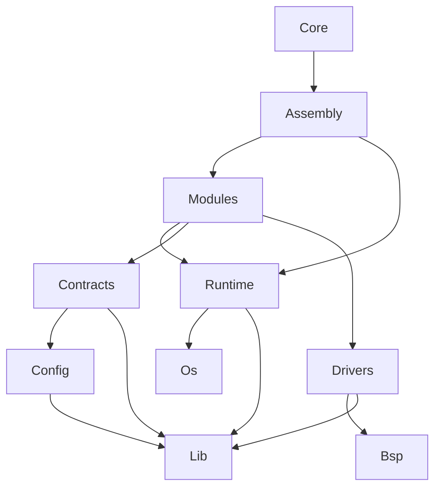

# RTOS 解耦与输入时效整改

本次处理输入时效、模块可见性、设备端口归属和旧算法边界，并检查自有代码的层级依赖和循环依赖。没有修改 PID 参数、线上协议、任务优先级、任务栈大小或正常控制节拍。

## 改动与行为

| 原问题 | 当前实现 | 修改位置 |
|---|---|---|
| valid 长期保留，控制无法判断指令是否过期 | 控制入口校验有效位及采样/接收时间；过期执行停止或复位 | Config/app_input_config.h、Contracts/app_data_age.h、控制适配入口 |
| Contracts 依赖 CAN 模块头 | 业务指令值和更新类别移至 Contracts/app_command_data.h；原始帧值也移至 Contracts | Contracts、can 模块 |
| 公共 include 路径暴露所有内部头 | 每模块独立 API 目标；生命周期、端口和旧算法头放 internal；跨模块依赖逐目标显式声明 | App/CMakeLists.txt、各模块 CMakeLists.txt |
| Runtime 包含具体任务和装配入口 | 任务清单展开、模块生命周期及创建回滚移至 Assembly/app_rtos_setup.c；Core 通过 app_boot.h 调用 | Assembly、Runtime、Core/Src/freertos.c |
| 任务反向调用 Assembly/app_devices | DBUS、裁判和 IMU 各自拥有端口实例及轮询；Assembly 只提供硬件配置和连接 | 各模块 app_task_*_port.c 与 internal/app_task_*_io.h |
| health 与 log 双向依赖 | log 读取 health 快照；health 通过启动前绑定的非阻塞事件回调提交日志 | health/internal、Assembly/app_rtos_setup.c |
| 旧数值转换与算法主体混在同一文件 | *_adapter.c 是 SI 输入策略及转换入口；旧算法单周期接口仅在本模块 internal 头声明 | gimbal、chassis、shoot |
| 云台通过文件级指针借用当前输入 | 本周期输入、IMU 和时间戳由参数显式传递 | app_sentry_gimbal.c |

模块 API 只传播公共头目录。Runtime 无模块 include 路径；功能模块无 Assembly 路径。旧算法 support/internal 只授予需要旧尺度的控制算法，装配层有明确的生命周期访问例外。Keil 的 include 路径仍是目标级合集，因此需运行依赖检查来执行相同的源码边界规则；不能宣称 Keil 自身提供了 CMake 的逐模块隔离。

## 输入时效规则

全部时间戳使用 1kHz 内核 tick。数据生产者写入采样或接收时刻，读取者不得刷新它。时间戳零是合法值，有效性另有标志。年龄判断为无符号差值，边界包含等号；约定实际时间间隔小于 2^31 tick，以支持正常计数回绕。

| 输入 | 最大年龄 | 过期处理 |
|---|---:|---|
| 云台 IMU | 10ms | 云台电流清零、PID 复位，发射命令进入急停 |
| 导航世界坐标 IMU | 20ms | 导航停止；保持此前世界坐标模式的阈值 |
| DBUS | 100ms | 已收到过遥控帧时，不自动回退 CAN；输入失效或过期进入停止 |
| 对应机构的每个电机反馈 | 50ms | 对应控制机构停止；其他机构不因无关电机缺失而停止 |
| 底盘 SPEED 指令 | 200ms | 停止并复位；ACKERMANN/FOLLOW 不更新 SPEED 的期限 |
| 云台 CAN 会话 | 200ms | 无任何有效命令类别时云台停止；新鲜会话内可保持已设定位置目标 |
| 云台 CAN 雷达速度 | 200ms，独立记录 | 速度字段归零；其他类别消息不能延长旧速度指令 |
| 云台 CAN 发射指令 | 200ms，独立记录 | 发射模式关闭；雷达流量不能延长旧发射指令 |
| 云台裁决后交给发射任务的命令 | 20ms | 发射电流清零并复位 PID |
| 哨兵底盘功率计 | 100ms | 停止底盘，避免持续使用旧功率闭环输入 |
| 云台底盘角速度补偿 | 20ms | 沿用原算法：失效后停止该补偿，使用相对速度阻尼 |

没有收到过 DBUS 时保留原 CAN 使用方式，但必须存在新鲜 CAN 会话。DBUS 新增 seen 位，与序号是否回绕无关。恢复后重新执行控制就绪对齐；CAN 发射在停止后不会凭旧更新位重新触发，需新的指令。健康模块仍只诊断，控制入口独立执行策略，两者共享适用的年龄阈值。

这些停止/恢复规则是本次有意增加的行为。上位机应持续刷新需要保持的速度和发射指令；不能再依赖一次非零命令永久保持运动或发射。具体阈值集中配置，须结合实际报文周期完成上板验证。

## 当前依赖关系



模块之间允许通过显式公共 API 调用。例如控制模块读取 CAN/DBUS/IMU、发布 telemetry；CAN 和输入模块更新 health；log 读取 health/telemetry。health 没有对 log 的头文件依赖；日志回调由 Assembly 连接。Runtime 不调用模块生命周期。Drv/Bsp/Lib/Os 不反向包含 App。

检查工具 `tools/check_dependencies.py` 解析真实头文件归属，检查相对路径越界、反向层级依赖、头文件环、模块环、层级环，并结合 compile_commands 检查算法目标是否看到平台或其他模块内部路径，以及是否经传递 include 引入平台头。

扫描保守地包含全部条件分支。结果只覆盖 Self_core 自有源文件及工程声明的编译路径，不覆盖第三方 HAL/RTOS 内部依赖，也不把运行期回调连接视为静态 include 环。

```powershell
cmake --preset GIMBAL_TEXT
cmake --build --preset GIMBAL_TEXT
cmake --build build/GIMBAL_TEXT --target check_dependencies
pwsh -NoProfile -File tests/host/run_tests.ps1
python tools/sync_keil_project.py --preset GIMBAL_TEXT
```

## 验证与限制

本轮上述九种固件配置均编译、链接通过，统一主机入口通过。200个自有文件的依赖扫描及九套实际编译路径检查均为零错误；CMake目标图无循环。架构检查五个反例测试通过，确认工具能拒绝反向依赖、内部头越界和循环等情况。Keil清单已同步78个自有源文件，保留原有板型及日志选择，未运行Keil编译。

固件矩阵包含云台/底盘 TEXT 与 VOFA、导航 TEXT 与 VOFA、两种裁判 UI，以及启用教学对象的云台 TEXT。主机统一入口包含架构检查反例、协议整数往返、真实任务装配失败注入、三种板型/车型下的控制策略、磁力计、IMU 与遥测测试。

新增时效测试覆盖有效性、年龄边界、时间戳零、tick 回绕、IMU/DBUS/CAN/功率计过期、每机构电机有效性、恢复、发射独立期限，以及导航断流。启动测试对云台17个和底盘15个创建步骤逐一注入失败，检查先终止线程、逆序删除模块资源、句柄清空、重试及成功后幂等。通用 Runtime 原语的 CMSIS 实现仍需配合目标平台验证。

控制算法仍由单个所属任务独占，适配工作副本继续位于静态 SRAM，未把大结构移入任务栈；不宣称控制 API 可重入或支持多实例。没有完成全输入空间的新旧动态算法等价证明，也没有进行上板实时性、实际断线和机构停止行为验收。现有模糊 PID 的有符号比较警告及部分板型裁剪后的未使用函数警告不属于本次修改范围。

## 后续优化与简化建议

1. 将 PID 十个位置参数改为具名配置结构体，降低调参和评审错位风险。
2. 将共享哨兵参数按云台、底盘、发射拆分；只有真实共享常量继续共用，避免新建“大公共头”。
3. 在回放测试充分后逐个算法迁移旧数值尺度；当前适配边界已独立，迁移时无需同时改任务和端口。
4. 需要多实例、并行仿真时再引入算法 context，当前单任务独占不强行增加上下文和注册框架。
5. CI 运行固件矩阵、主机统一入口及依赖检查；文档检查应先修复旧正则误报，再作为强制门槛。
6. 将新增任务的任务清单、生命周期创建/回滚、板型能力与测试更新列为评审清单。当前显式装配比通用模块注册器更容易阅读。
