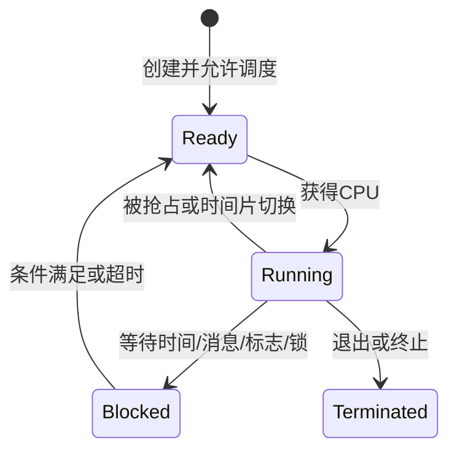
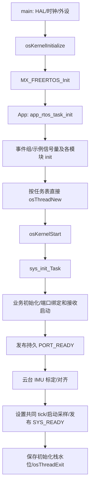
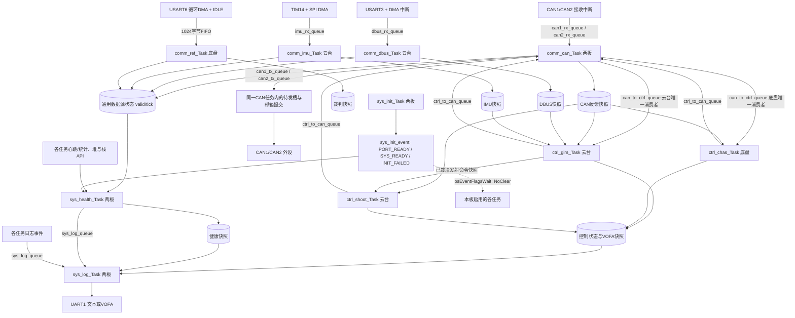
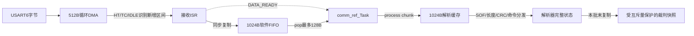
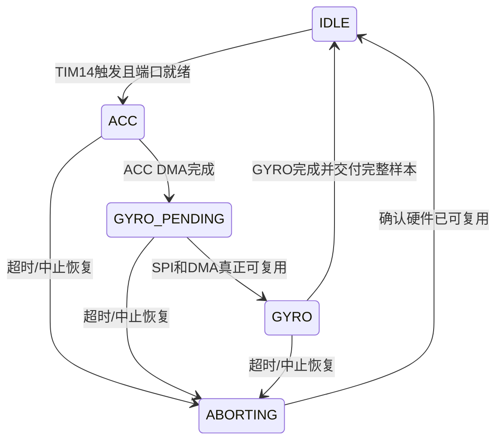

# 哨兵工程 FreeRTOS 架构学习与开发指南

> 面向读者：会写 STM32 裸机程序，了解任务和延时，希望掌握 RTOS 并发、任务通信、DMA 接收及工程开发。
>
> 对应工程：`D:/STM32project/BNGU_Control_System_FreeRTOS`。
>
> 运行环境：STM32F407、FreeRTOS V10.3.1、CMSIS-RTOS2 适配层、1 kHz 内核 tick、哨兵车型。
>
> 本文按当前源码解释架构、接口和使用步骤。示例用于说明调用规则；实际入口、数据类型和配置以配套源码为准。文中相对于 `Self_core/` 的路径均省略该目录前缀，`Core/`、`Middlewares/`、`tools/` 和根构建文件除外。

## 阅读路线与目录

第一次阅读按 **1 → 2 → 3 → 4 → 5 → 7 → 9 → 12**：先理解任务如何运行、数据归谁、各层负责什么，再看通信和接收实现。开发时查第 19～23 节；在 Keil 中观察运行状态时查第 25 节。

| 章节 | 解决的问题 |
|---|---|
| [1. RTOS 的运行方式](#s01) | 任务是不是函数？优先级能否保证固定执行顺序？ |
| [2. 层级与职责](#s02) | App、Os、Bsp、Drv、Lib 怎样分工和适配平台？ |
| [3. 目录与调用关系](#s03) | 文件在哪里？从 main 到控制输出经过哪些文件？ |
| [4. 十个任务](#s04) | 每个任务做什么，为什么这样拆？ |
| [5. 初始化](#s05) | 对象创建、端口就绪、系统就绪如何衔接？ |
| [6. 周期与时间](#s06) | osDelayUntil、漏周期、回绕、硬件定时器怎么用？ |
| [7. 全部通信关系](#s07) | 每条数据流使用什么对象，谁负责对象的生命周期？ |
| [8. 队列与值传递](#s08) | 传结构体还是指针？容量如何确定？ |
| [9. 快照与互斥量](#s09) | 如何读到完整状态？读不到怎么办？ |
| [10. 标志与信号量](#s10) | 线程标志、任务通知、事件组、信号量有什么区别？ |
| [11. 中断、回调与 Hook](#s11) | 谁调用谁？哪些接口能在中断里用？ |
| [12. 裁判接收全过程](#s12) | DMA 环形缓冲、软件 FIFO、解析缓存逐步解释 |
| [13. DBUS 双缓冲](#s13) | 固定帧接收为什么使用两块缓冲？ |
| [14. IMU 状态机](#s14) | 硬件节拍、SPI DMA、任务解算如何衔接？ |
| [15. CAN 收发](#s15) | 六个队列、待发槽和处理预算分别做什么？ |
| [16. 日志与串口所有权](#s16) | 日志怎样发送，异步发送缓冲何时可以复用？ |
| [17. 内存、栈、堆与内存池](#s17) | 日志里的空闲内存究竟指什么？ |
| [18. 健康监测与测时](#s18) | 在线、心跳、运行耗时有哪些实际含义？ |
| [19. 配置与 CubeMX](#s19) | 哪些由 CubeMX 管，构建和板型怎样选择？ |
| [20. 开发步骤与文件入口](#s20) | 编写业务、任务、快照、中断和协议的具体步骤 |
| [21. 命名与接口约定](#s21) | 项目函数、CMSIS API 和 HAL API 怎样区分？ |
| [22. 排查问题](#s22) | 常见现象首先检查哪里？ |
| [23. 函数/API/配置索引](#s23) | 阅读源码时查函数职责与使用约束 |
| [24. 源码与官方资料](#s24) | 哪些资料适合配合本地实现阅读？ |
| [25. Keil 调试与运行观察](#s25) | Watch 看什么，怎样解读快照、计数和运行状态？ |

<a id="s01"></a>
## 1. 先建立正确的 RTOS 运行方式

### 1.1 一个任务是“独立的执行过程”

裸机常见写法：

```c
for (;;)
{
    read_remote();
    update_imu();
    control_gimbal();
    control_shoot();
    send_log();
}
```

一处等待会推迟后面的所有工作。使用 RTOS 后，每个任务有自己的入口、栈、运行位置和等待条件。调度器在任务之间切换，使不同工作可以分别等待自己的时刻或数据。

STM32F407 是单核：**某一瞬间只有一个任务执行指令**。中断还可以打断任务。所谓并发，是这些执行过程在时间上交错推进。

任务入口通常是无限循环，但循环里必须通过延时、等待队列、等待标志等方式合理让出 CPU。高优先级任务如果始终处于就绪状态，低优先级任务可能长期无法执行。

### 1.2 四种常用状态



“阻塞”不是卡死。正常的事件任务大部分时间都应该阻塞，等待数据到达。

`osDelayUntil()` 返回之前，任务曾因时间等待而阻塞；到达目标 tick 后，它具备运行资格。真正执行还受更高优先级任务和中断影响。

### 1.3 RTOS 不会自动给全部函数排一个固定顺序

当前工程使用抢占调度。高优先级的**就绪任务**优先获得 CPU；高优先级任务正在等待数据时，低优先级任务仍可以运行。

本工程在同一控制节拍上，云台优先级高于发射。因此二者同时就绪时，云台通常先裁决发射命令。但这不能替代数据同步：云台、IMU、CAN 都可能等待、超时或被中断打断；每个输入还必须带时间和有效性。

你设计 RTOS 架构时，要分别回答：

1. 这件事什么时候做：固定周期，还是数据到达？
2. 谁拥有这个状态：哪个任务可以修改？
3. 谁需要读取：只给一个消费者，还是多个读取者？
4. 允许丢中间值吗：只关心最新状态，还是每个事件都要处理？
5. 等不到资源怎么办：等待、用旧值、丢弃，还是进入故障处理？

### 1.4 先认识这些词

| 词 | 本工程中的含义 |
|---|---|
| tick | 内核节拍计数；当前 1000 Hz，因此 1 tick = 1 ms |
| 周期 | 相邻计划执行时刻的间隔，例如云台 1 tick |
| 句柄 Handle | 内核对象的标识，例如 `comm_can_TaskHandle`；不等同于任务数据 |
| ISR | 中断服务过程，包括在该中断里同步调用的回调 |
| 上下文 | 代码当前是在某个任务里执行，还是在中断里执行 |
| IPC | 任务/中断之间交付数据或同步执行的机制 |
| 快照 | 某份共享状态在一次完整复制时取得的副本 |
| 数据年龄 | 当前 tick 减去这份有效数据对应的 tick |
| 背压 | 消费不及生产时，如何约束生产或处理积压 |
| 所有权 | 谁可以写数据、复用缓冲区、释放对象 |

<a id="s02"></a>
## 2. App、Os、Bsp、Drv、Lib 分别负责什么

### 2.1 先按职责辨认

| 位置 | 负责什么 | 具体入口 |
|---|---|---|
| `App/Config` | 板型、控制周期、容量和处理预算 | `app_board_config.h`、`app_control_config.h`、`app_rtos_config.h` |
| `App/sentry`、`App/common` | 控制、输入转换、协议和值类型 | `app_sentry_*`、`app_control`、领域数据头 |
| `App/Tasks/<任务>` | 等待、取消息、读快照、调用算法、发布结果 | `app_task_<任务>.c/.h` 同目录配对 |
| `App/Tasks/common` | 应用任务表、创建、启动同步、统计和公共发布 | `app_rtos.c`、`app_tasks.c`、telemetry、monitor |
| `App/Tasks/init` | 本板启动顺序、设备回调绑定、标定和 TIM14 启动 | `app_task_init.c`、`app_rtos_board.c` |
| `App/Tasks/can/*_port`、`log/*_port` | 任务服务到 STM32 外设的接入 | CAN 邮箱、UART1 发送事务 |
| `Os/FreeRTOS` | 通用对象操作、快照复制、内核堆统计及 Hook | `app_rtos_objects`、`app_rtos_kernel` |
| `Os/Port` | CPU 测时、短临界区、内存屏障 | `app_rtos_port.c`、`app_rtos_time.h` |
| `Drv` | 设备协议、解析、换算和对应设备端口 | BMI088、DBUS、裁判、电机等 |
| `Bsp` | HAL 外设操作、回调分发 | CAN/UART/SPI/TIM 等 |
| `Lib` | 通用 PID、滤波、数学和时间计算 | 不包含 App、Os、HAL |

Os 提供通用机制，接口不依赖具体任务、板型或 CAN 业务协议。CPU 端口使用 CMSIS 设备头访问 DWT、PRIMASK 等寄存器；FreeRTOS 内核适配使用当前内核的堆统计和 Hook。应用决定机制用于什么业务。

### 2.2 用一次控制过程判断代码放哪里

```text
CAN 中断取帧（Bsp）
  → CAN 端口转换总线号（App/Tasks/can/*_port）
  → 原始帧入队与唤醒（App/Tasks/can）
  → 哨兵协议解析（App/sentry/app_sentry_can）
  → 语义指令入队（App/Tasks/can）
  → 控制任务整理输入（App/Tasks/gimbal 或 chassis）
  → PID/运动学（App/sentry）
  → 控制结果入队（App/Tasks）
  → 协议编码、待发管理、提交邮箱
```

PID 和控制策略由 App 管理，CAN ID 和线协议由协议模块管理，UART 发送由日志端口管理。任务的配置和装配集中在 App/Tasks，Os 提供这些任务共同使用的通用机制。

### 2.3 名字与系统 API

`osThreadNew()`、`osMessageQueuePut()`、`osDelayUntil()` 是 CMSIS-RTOS2 接口。`HAL_*` 属于 STM32 HAL。`app_rtos_*` 是项目函数前缀，具体所属层由声明头、目录和职责确定；第 21 节给出命名速查。

任务层直接使用 CMSIS API。项目公共函数承担共同规则：`app_rtos_object_mutex()` 统一优先级继承与创建规则，`app_rtos_notify_task()` 检查任务编号、句柄和通知错误，`app_tasks_period_wait()` 处理绝对节拍、漏周期和等待结果。

### 2.4 更换平台时的适配边界

| 变化 | 需要适配的位置 | 通过什么接口连接 |
|---|---|---|
| STM32F407 换成其他 MCU | Core、Bsp、Drv 设备端口、CAN/log 任务端口、板级装配、Os CPU 端口 | 设备回调、任务端口接口、测时/临界区接口 |
| FreeRTOS 换成其他内核 | CMSIS 后端、Os 内核统计与 Hook、tick 配置 | CMSIS-RTOS2 API、`app_rtos_memory_read()` 等机制接口 |
| 更换 IMU 或串口设备 | 对应 Drv 和设备端口、板级装配 | 完整样本/解包结果以及有效性、时间戳 |
| 调整控制策略 | App 的对应控制模块、领域输入输出类型、任务的数据组织 | 输入值副本、算法输出、结果提交接口 |

纯 App 算法使用值类型、数学库和自身状态。App/Tasks 负责 RTOS 执行过程，因此依赖 CMSIS；Bsp 和各端口实现硬件访问。将代码移到另一平台时，按这些明确的接口提供对应实现。

<a id="s03"></a>
## 3. 文件层级与调用关系

### 3.1 目录与文件职责

```text
Self_core/
  App/
    Config/                     板型、周期、容量、模块阈值
      app_task_list.def         统一任务清单：编号、句柄、创建与启动属性
    common/
      data/                     各领域值类型、快照、输入/输出、槽位
      communication/            原始 CAN 帧、云台/底盘协议
      system/                   业务初始化和控制输入处理
    sentry/
      app_sentry_can.c/.h        哨兵 CAN 协议编解码
      gimbal/ chassis/ shoot/   纯控制算法
    Tasks/
      common/
        app_rtos.c/.h           清单展开、对象装配、启动事件
        app_rtos_types.h        从清单生成任务编号；统计、通知位
        app_tasks.c/.h          应用等待与周期统计工具
        app_task_monitor.c/.h   通用在线状态
        app_task_telemetry.c/.h 控制状态与 VOFA 映射
      init/
        app_task_init.c/.h      初始化任务入口
        app_rtos_board.c/.h     本板硬件及应用装配
      can/
        app_task_can.c/.h       CAN 工作循环和私有对象
        app_task_can_port.c/.h  CAN 硬件接入
      log/
        app_task_log.c/.h       日志/内存报告/发送策略
        app_task_log_port.c/.h  UART1 事务与完成/错误回调
      gimbal/ chassis/ shoot/ dbus/ imu/ referee/ health/
                                各任务自己的 .c/.h
  Os/
    FreeRTOS/
      app_rtos_objects.c/.h     通用对象和快照复制
      app_rtos_kernel.c/.h      堆统计及 FreeRTOS Hook
    Port/
      app_rtos_port.c           STM32 CPU 适配
      app_rtos_time.h           测时/临界区契约
  project_cfg.h                 车型、板型及日志模式的默认配置
  Drv/                          协议/设备及设备端口
  Bsp/                          HAL 外设接入
  Lib/                          PID/滤波/数学
```

同一任务的入口、私有资源接口及配套硬件端口放在对应任务目录。`App/common/data` 按云台、底盘、IMU、裁判等领域定义值类型；任务之间传递这些值，不在业务数据中夹带 RTOS 句柄。

### 3.2 源码阅读顺序

1. `Self_core/project_cfg.h` 与 `App/Config/app_board_config.h`：车型和板型能力。
2. `App/Config/app_task_list.def`：全部任务的编号、句柄、入口和属性。
3. `App/Tasks/common/app_rtos.c`：清单生成的任务表及唯一创建入口。
4. `App/Tasks/init/app_task_init.c`：调度器启动后的初始化顺序。
5. `App/Tasks/init/app_rtos_board.c`：本板硬件装配。
6. `App/Tasks/common/app_tasks.c`：周期等待和统计。
7. 对应任务的 `.c/.h`，再进入它调用的 App 算法或 Drv 解析器。

### 3.3 启动调用链



### 3.4 句柄、extern 与 static

任务句柄由 `app_task_list.def` 在 `App/Tasks/common/app_rtos.c` 中展开定义，在 `app_tasks.h` 中展开 `extern` 声明。它们仍是普通的全局变量，任务表引用这些变量的地址，创建线程后向其中写入句柄。通信对象句柄是所属模块 `.c` 内的 `static` 变量：CAN 六队列归 CAN，DBUS 队列和锁归 DBUS，其他模块同理。

外部使用 `app_rtos_dbus_read()`、`app_rtos_ctrl_send()` 等领域接口，不通过 `extern` 任意访问内部队列或锁。传给函数的指针只用于本次复制；队列实际保存值副本。

<a id="s04"></a>
## 4. 当前十个任务逐个解释

### 4.1 任务表

以下栈均为 `osThreadAttr_t.stack_size` 的**字节数**。任务属性在 `App/Config/app_task_list.def` 中填写，由它生成当前 `app_rtos_task_table`。

| 任务对象名 | 当前板型 | 优先级 | 栈/B | 运行方式 | 每轮主要工作 |
|---|---|---|---:|---|---|
| `sys_init_Task` | 两种 | `osPriorityHigh3` | 1024 | 一次性 | 初始化业务、端口、IMU，发布 READY，退出 |
| `comm_imu_Task` | 云台 | `osPriorityHigh2` | 1536 | 样本/状态事件，最长 1 tick 等待 | 解码、转换物理量、Mahony、欧拉角、发布姿态 |
| `comm_can_Task` | 两种 | `osPriorityHigh1` | 1024 | 接收/邮箱/错误事件，按 tick 限额 | 双 CAN 收发、协议解码、反馈快照、编码与邮箱管理 |
| `ctrl_gim_Task` | 云台 | `osPriorityHigh` | 1536 | 1 tick 绝对周期 | 控制源裁决、双 yaw/pitch 控制、发布发射命令 |
| `ctrl_chas_Task` | 底盘 | `osPriorityHigh` | 1536 | 1 tick 绝对周期 | 指令、双舵轮运动学、PID、功率计闭环 |
| `ctrl_shoot_Task` | 云台 | `osPriorityAboveNormal3` | 1024 | 5 tick 绝对周期 | 执行已裁决模式、摩擦轮与拨弹轮控制 |
| `comm_dbus_Task` | 云台 | `osPriorityAboveNormal2` | 1024 | 帧事件，最长 50 tick 等待 | 解包 18 字节、校验、归一化、发布遥控快照 |
| `comm_ref_Task` | 底盘 | `osPriorityAboveNormal1` | 1024 | 字节事件，最长 50 tick 等待 | 消费 FIFO、组帧/CRC/解包、批量发布裁判快照 |
| `sys_health_Task` | 两种 | `osPriorityBelowNormal` | 768 | 20 tick 绝对周期 | 在线、心跳、丢包、漏周期、任务栈和堆 |
| `sys_log_Task` | 两种 | `osPriorityLow` | 1024 | TEXT 事件+每秒报告；VOFA 5 tick | 独占 UART1，格式化并发送 |

`TASK_COUNT=10` 表示十种任务，不能据此推断本板创建了十个：

- 云台板创建 8 个，初始化正常退出后剩 7 个常驻应用任务。
- 底盘板创建 6 个，初始化正常退出后剩 5 个常驻应用任务。
- 未创建的句柄为 `NULL`；健康监测会标记未启用。
- FreeRTOS 还有 Idle 任务及启用软件定时器支持时的定时器服务任务。它们不在这十个应用任务的表里。

### 4.2 为什么把 IMU、DBUS、裁判分别拆任务

它们触发条件和工作量不同：IMU 是 1 kHz 采样后的姿态处理，DBUS 是完整遥控帧到达后的短解包，裁判则是可变长度字节流的组帧和 CRC。

独立任务允许分别设置优先级、处理预算、错误恢复和统计。如果都塞进一个输入任务，长裁判数据处理可能推迟 IMU。独立也有栈和切换开销，拆分应围绕实时要求与所有权，不应机械地“一种外设一个任务”。

当前拆分与这些要求相符。实际是否满足 1 ms 截止时间，还需看 CPU 负载、中断、最大处理时间和真实硬件测量，不能只看优先级表。

### 4.3 为什么控制算法由控制任务独占

PID 积分、滤波历史、目标累计量等都属于可变状态。如果多个任务同时修改同一个 PID，锁只能保护某次访问，很难保证整个算法更新的业务顺序。

当前云台、底盘、发射分别拥有自己的算法状态。其他任务交付输入，控制任务产生输出。这样能明确“每个控制周期只更新一次”，也便于迁移和分析时序。

### 4.4 统一任务清单怎么读

`App/Config/app_task_list.def` 使用 C 预处理器的 X Macro 写法：同一份清单被不同文件包含，每次先定义不同的 `APP_TASK`，就能分别生成编号、声明、变量和表项。整个过程发生在编译前，不需要 YAML 解析器或额外的代码生成脚本。

例如云台任务的完整配置是：

```c
APP_TASK(
    TASK_GIM,
    ctrl_gim_TaskHandle,
    Start_ctrl_gim_Task,
    .name = "ctrl_gim_Task",
    .stack = 1536,
    .priority = osPriorityHigh,
    .enabled = APP_BOARD_HAS_GIMBAL,
    .start_flags = APP_RTOS_EVT_SYS_READY
)
```

前三项依次是任务编号名、句柄变量名、入口函数名。后面的 `.成员 = 值` 是 `app_rtos_task_desc_t` 的具名属性，顺序不影响含义。

| 字段 | 含义 |
|---|---|
| `.name` | 调试器中显示的线程名称，与入口函数名分别填写 |
| `.stack` | 线程栈大小，单位字节 |
| `.priority` | CMSIS-RTOS2 优先级 |
| `.enabled` | 当前板是否创建线程；为 0 时保留编号与空句柄 |
| `.start_flags` | 首次等待 `PORT_READY`、`SYS_READY`，或 0 表示不等待 |
| `.diagnostic_on_failure` | 初始化失败后是否仍执行诊断，未填写为 0 |
| `.one_shot` | 一次性任务的生命周期标记，未填写为 0；任务仍须主动保存完成状态并 `osThreadExit()` |

`handle` 和 `entry` 由前三个参数生成，不在后面的具名属性中重复填写。入口函数的声明仍放在所属任务 `.h`，由 `app_rtos.c` 包含；清单不替代函数实现或任务工作循环。

### 4.5 一份清单怎样变成四处代码

| 包含位置 | 本次 `APP_TASK` 做什么 | 生成的内容 |
|---|---|---|
| `app_rtos_types.h` | 只取第一个参数 | `TASK_CHAS` 到 `TASK_LOG` 的枚举，末尾自动得到 `TASK_COUNT` |
| `app_tasks.h` | 只取句柄名并加 `extern` | `extern osThreadId_t ctrl_gim_TaskHandle;` 等声明 |
| `app_rtos.c` 的句柄区 | 只取句柄名 | `osThreadId_t ctrl_gim_TaskHandle;` 等变量定义 |
| `app_rtos.c` 的任务表区 | 组合编号、句柄地址、入口和具名属性 | `app_rtos_task_table[TASK_COUNT]` 的全部表项 |

以生成编号为例，实际写法是：

```c
enum
{
#define APP_TASK(task_id, task_handle, task_entry, ...) task_id,
#include "app_task_list.def"
#undef APP_TASK
    TASK_COUNT
};
```

其中 `...` 接收后续属性，`__VA_ARGS__` 表示这些属性；生成编号时不使用它们。生成任务表时，宏将它们放进结构体初始化器。每次包含后立即 `#undef APP_TASK`，避免影响后面的代码。`.def` 有意没有头文件保护宏，否则只能生成第一处代码。

现有编号按清单顺序保持为：`TASK_CHAS=0`、`TASK_GIM=1`、`TASK_SHOOT=2`、`TASK_CAN=3`、`TASK_DBUS=4`、`TASK_REF=5`、`TASK_IMU=6`、`TASK_INIT=7`、`TASK_HEALTH=8`、`TASK_LOG=9`。

维护规则：

- 新任务追加到清单末尾，保持已有编号稳定；不要按优先级重排。
- 板型选择使用 `.enabled`，不要用 `#if` 删除清单项，否则两种板的编号可能不同。
- 任务未启用仍需要入口声明和可编译实现；`.enabled` 控制创建，不负责裁剪源文件。
- 修改栈、优先级、显示名称或启动条件，只改该任务的清单记录；周期仍在 `app_control_config.h` 或所属任务配置中维护。
- 编号、句柄声明/定义和运行任务表均由清单生成，不手工再写一份。
- 队列、锁和快照的生命周期在所属模块的 `init/deinit` 中维护；硬件绑定在板级装配或端口中维护。

创建阶段仍由 `app_rtos_task_init()` 遍历生成的表，直接调用 `osThreadNew()`。运行中的通知、启动等待、日志和健康监测继续使用同一组编号与表项。清单本身不创建线程，也不占用额外的运行期任务栈或消息存储。

<a id="s05"></a>
## 5. 初始化：为什么分对象创建、端口就绪、系统就绪

### 5.1 调度器启动前：创建对象和线程

```text
osKernelInitialize()
  → MX_FREERTOS_Init()
      → app_rtos_task_init()
          → sys_init_event + 示例二值信号量
          → app_task_can_init()
          → app_task_dbus_init()
          → app_task_imu_init()
          → app_task_shoot_init()
          → app_task_referee_init()
          → app_task_health_init()
          → app_task_log_init()
          → app_task_telemetry_init()
          → 初始化通用在线状态表
          → 遍历任务表，直接 osThreadNew()
  → osKernelStart()
```

每个对象所有者提供一个 `init()`，负责清零私有数据并创建队列、互斥量等资源；配套 `deinit()` 负责删除已创建的对象。任务表只描述线程配置。云台、底盘控制任务的算法状态由业务初始化建立，它们没有独立通信对象时无需对象初始化入口。

通信对象统一创建，线程根据任务表的板型条件创建。因此某些对象在本板没有业务消费者。创建失败时，先终止尚未运行的已创建线程，再逆序调用各模块 `deinit()` 删除非空对象。

首次创建要求内核处于 `osKernelReady`；成功后重复调用直接返回。此入口不支持热重启。分配失败 Hook 可能先停机，所以回滚不是分配失败后的必达路径。

### 5.2 调度器启动后：初始化业务和硬件

`sys_init_Task` 可以使用任务延时，按以下顺序执行：

1. `app_rtos_board_init()`：初始化 App、CPU 测时、日志 UART 回调、LED/蜂鸣器和设备回调。
2. `app_rtos_ports_start()`：启动 CAN、DBUS 或裁判接收。
3. `app_rtos_publish_init(APP_RTOS_EVT_PORT_READY)`：一次设置事件组，允许通信与诊断运行。
4. 云台板配置 IMU、完成 3000 次标定并发布初始姿态；标定等待会让出 CPU。
5. 保存共同起点 `app_rtos_start_tick = 当前 tick + 2`。
6. 云台板启动 TIM14，设置 `APP_RTOS_EVT_SYS_READY`。
7. 保存自身栈水位、完成状态，清空句柄并退出。

对象创建与硬件启动分属两个阶段：模块 `init()` 在调度器启动前建立可用的软件存储；`sys_init_Task` 在调度器启动后绑定设备并允许数据进入。ISR 发布数据前，接收对象和任务句柄必须有效。

### 5.3 同一个事件组保存三种启动事实

| 事件 | 意义 | 等待者 |
|---|---|---|
| `APP_RTOS_EVT_PORT_READY` | 回调和接收端口可用 | CAN、DBUS、裁判、健康、日志 |
| `APP_RTOS_EVT_SYS_READY` | 业务及必要标定完成 | 三个控制任务、IMU；VOFA 额外等待 |
| `APP_RTOS_EVT_SYS_INIT_FAILED` | 初始化某一步明确失败 | 所有仍在启动门控中的任务 |

任务调用 `app_tasks_wait_start(TASK_...)`，按任务表的 `start_flags` 等待 `sys_init_event`，等待选项为 `osFlagsWaitAny | osFlagsNoClear`。事件组保存启动状态，供多个等待者读取。

事件不清除：任务稍晚执行也能看到已发布的 READY。等待每 50 tick 超时维护心跳。若 READY 与 FAILED 同时存在，先按 FAILED 处理；健康/日志允许继续诊断，其他仍在门控中的任务进入等待状态。

### 5.4 启动状态与设备在线分开

外部模块未在线不无限阻塞系统 READY；有效性、时间戳和健康监测负责描述在线情况。CAN 在 SYS_READY 前解析反馈，但丢弃旧的控制增量，防止标定期间的历史指令集中重放。

已经通过 PORT_READY 的通信任务可继续接收；失败位不会自动终止已经运行的任务。心跳存在也不等于控制计算已经开始，应同时观察 `ready/init_failed/cycles`。

<a id="s06"></a>
## 6. 周期任务、绝对时间与硬件节拍

### 6.1 `osDelay`、`osDelayUntil`、软件定时器

| 方式 | 含义 | 当前用途 |
|---|---|---|
| `osDelay(n)` | 从调用时起按 tick 等待 | 初始化等待、失败退避、恢复检查 |
| `osDelayUntil(t)` | 等待到绝对 tick `t` | 云台、底盘、发射、健康、VOFA |
| `osTimerNew()` | 创建软件定时器，在定时器服务任务中执行回调 | 当前业务未创建这种对象 |
| TIM14 中断 | 硬件定时触发 ISR | 云台 IMU 采样触发 |

所以“控制使用软件定时器的 osDelayUntil”准确说法是：**控制在任务中使用绝对 tick 延时，按固定周期调度。** 它不是软件定时器回调。[CMSIS 延时接口](https://arm-software.github.io/CMSIS_6/latest/RTOS2/group__CMSIS__RTOS__Wait.html)

假设一次计算耗时约 0.3 ms：如果每次计算后再相对延时 1 ms，计算时间会参与循环周期。绝对节拍则沿 `101、102、103……` 这样的计划时刻推进，不把每轮耗时累加进计划周期。

### 6.2 当前任务如何安排首轮

- 云台/底盘：`next = app_rtos_start_tick + 1`。
- 发射/VOFA：`next = app_rtos_start_tick + 5`。
- 健康：按其启动后的时间建立 20 tick 周期。

三个控制任务独立等待各自的绝对节拍。IMU 更新姿态快照，云台更新发射输入快照；控制任务在自己的周期读取最近完整副本。输入更新不会直接触发另一控制任务执行。

### 6.3 为什么不能只写一行 `osDelayUntil(next)`

任务可能被打断太久，`next` 已过去；也可能检查时间时还没到，调用 API 时刚好已经到。当前 `app_tasks_period_wait()` 统一处理这些情况：

1. 取得当前 tick，调用纯计算函数 `lib_periodic_skip_expired()`。
2. 严格过期则计入 `missed`，把目标推进到未来，避免连续补算旧周期。
3. 如果当前 tick 恰好等于目标，直接执行本轮。
4. 否则调用 `osDelayUntil(next)`。
5. 若调用期间发生“目标刚到/已过”的竞争，重新判断时间。
6. 真正的 API 异常才增加 `delay_errors`，短暂延时后重试。
7. 开始本轮前记录唤醒延迟和心跳。
8. 业务处理结束后由调用者执行 `next += period`。

教学简化版，省略诊断和 API 竞争处理：

```c
uint32_t next = common_start_tick + period;
for (;;)
{
    /* 当前工程应使用已有 app_tasks_period_wait()，不要用这个片段替换它。 */
    missed += lib_periodic_skip_expired(osKernelGetTickCount(), period, &next);
    if (osKernelGetTickCount() != next)
    {
        /* 完整实现必须检查返回值并处理检查后目标到期的竞争。 */
        (void)osDelayUntil(next);
    }
    run_one_current_cycle();
    next += period;
}
```

`app_tasks_period_wait()` 现在是 `app_tasks.c` 中的共用调度函数，由 `app_tasks.h` 声明；各独立任务文件复用同一份实现，避免复制出不同的漏周期处理。

### 6.4 具体时间例子

以下是**进入等待辅助函数时**的情况，周期为 5 ticks：

| 当前 now | 计划 next | 处理结果 |
|---:|---:|---|
| 98 | 100 | 等到 100 |
| 100 | 100 | 本轮到期，执行一次 |
| 102 | 100 | 100 已过，`missed += 1`，等待 105 |
| 105 | 100 | 原计划已过，按当前策略跳过 100 和 105，`missed += 2`，等待 110 |

最后一行是当前“已过期后推进到严格未来时刻”的策略。它不同于“原计划就是 105，当前也是 105”的情况，后者会直接执行。

若任务先成功阻塞到 100，却因其他高优先级工作直到 102 才真正运行，`osDelayUntil()` 仍可能成功返回并执行这一轮，延迟由 `max_wakeup_us` 反映。**过期跳过与唤醒后被抢占延迟是不同指标。**

### 6.5 tick 回绕如何处理

`uint32_t` tick 自然回绕。1 kHz 时完整周期约 49.7 天，不能简单用 `now > deadline` 判断跨回绕先后。

当前周期工具使用：

```c
int32_t lateness = (int32_t)(now - next);
```

这适用于比较间隔小于 `2^31` ticks 的时间点。年龄通常用无符号减法：

```c
uint32_t age = (uint32_t)(now - data_tick);
```

它同样要求业务超时和实际检查间隔在合理范围内，不能靠一个 32 位时间戳区分跨越若干整圈后的年代。

### 6.6 四种计时不要混淆

| 来源 | 当前作用 |
|---|---|
| SysTick / 内核 tick | RTOS 延时、超时、任务时间戳 |
| TIM6 HAL 时基 | `HAL_GetTick()` 等 HAL 时间服务 |
| TIM14 | 云台板 1 kHz IMU 采样中断；底盘板不启动 |
| DWT CYCCNT | 微秒级经过时间、采样间隔、唤醒延迟测量 |

PWM 仍由硬件定时器产生。控制计算放任务里，不意味着要把 PWM 改成任务反复翻转 GPIO。

当前 1 tick = 1 ms 是工程配置，不能推广到所有 CMSIS 工程。`osDelay(1)` 也不保证墙钟恰好过去 1 ms：调用时距下一个 tick 可能只剩很短时间。修改 tick 频率时必须一起核对周期、超时、测时换算和 IMU 参数。

<a id="s07"></a>
## 7. 所有任务与通信关系

### 7.1 总图

图中十种任务全部列出，但不会在同一板型全部创建。箭头旁写的是数据承载方式；线程标志负责唤醒，不保存这些载荷。



裁判任务发布机器人状态、功率和热量等快照。底盘的功率控制使用固定 100 W 目标和功率计闭环；裁判快照中的功率与热量字段供读取，当前控制路径不使用这些字段施加限制。第 20 节说明如何接入这类业务输入。

### 7.2 六个 CAN 队列

| 对象 | 生产者 → 消费者 | 消息类型 | 容量 |
|---|---|---|---:|
| `can1_rx_queue` | CAN1 ISR → CAN 任务 | `app_can_frame_t` | 32 |
| `can2_rx_queue` | CAN2 ISR → CAN 任务 | 同上 | 32 |
| `can_to_ctrl_queue` | CAN → 云台或底盘主控制任务 | `app_can_ctrl_msg_t` | 16 |
| `ctrl_to_can_queue` | 本板各控制任务 → CAN | `app_ctrl_can_msg_t` | 16 |
| `can1_tx_queue` | CAN 任务编码阶段 → 发送阶段 | `app_can_frame_t` | 16 |
| `can2_tx_queue` | CAN 任务编码阶段 → 发送阶段 | 同上 | 16 |

两个 TX 队列属于同一 CAN 任务内部流水过程，不代表另外创建了两个发送任务。

### 7.3 其余载荷通道

| 通道 | 传什么 | 为什么这样选 |
|---|---|---|
| `dbus_rx_queue`，4 条 | 18 字节完整帧、tick、序号 | 固定帧，复制简单，不暴露 DMA 地址 |
| `imu_rx_queue`，4 条 | 完整 ACC/GYRO 原始采样和触发时间 | 解算需要按样本处理，ISR 不做 AHRS |
| 裁判 FIFO，1024 B | 按先后排列的字节流 | DMA 片段不等于协议帧，先保存连续顺序 |
| `sys_log_queue`，16 条 | 时间、来源、级别、事件码、两个整数 | 控制任务不承担字符串格式化和串口等待 |
| DBUS 快照 | 摇杆/开关/鼠标/键盘及有效性 | 多处读取最近完整输入 |
| 发射命令快照 | 云台已裁决的来源、模式、状态 | 发射执行统一的裁决结果 |
| IMU 快照 | ACC、GYRO、四元数、欧拉角、时间 | 云台按自身周期读取最新完整姿态 |
| CAN 反馈快照 | 电机、功率计、底盘角速度和独立时间 | 多个控制/诊断读取者不能争抢反馈队列 |
| 裁判快照 | 各类协议状态、字段时间、批次更新掩码 | 同时保存多种低频与高频字段 |
| 控制状态快照 | 目标/实际/电流/VOFA 通道 | 控制输出与日志解耦 |
| 通用数据源状态 | valid、最近有效 tick、错误/忙计数 | 健康只读小状态，不复制协议数据 |
| 健康快照 | 在线表、任务表、堆栈、错误计数 | 诊断读取完整一份报告 |

### 7.4 选型口诀及其边界

| 需求 | 优先考虑 | 需要留意 |
|---|---|---|
| 每条独立消息交给一个消费者 | 队列 | 有限容量；满了必须有策略 |
| 多个读取者需要最近状态 | 快照+互斥量 | 中间状态会被覆盖；检查时间 |
| 叫醒某一个任务 | 线程标志 | 同一位多次设置会合并 |
| 多任务查询系统状态组合 | 事件标志组 | 自动清位会改变后续查询结果 |
| 只表示一次完成/一个许可 | 信号量 | 不携带载荷；二值只能记住一次 |
| 保护共享资源的所有权 | 互斥量 | 任务上下文使用；锁内工作短 |
| 连续字节到达、协议边界未知 | 字节 FIFO+解析器 | 处理溢出、重同步及生产者规则 |

这些机制可以组合。当前“队列+线程标志”就是：队列保存消息，标志让一个负责多种事件的任务及时醒来。

### 7.5 通信对象由谁持有

| 所有者 | 模块内的对象 | 生命周期入口 |
|---|---|---|
| CAN | `can1_rx_queue`、`can2_rx_queue`、`can1_tx_queue`、`can2_tx_queue`、`can_to_ctrl_queue`、`ctrl_to_can_queue`、`can_feedback_mutex` | `app_task_can_init/deinit()` |
| DBUS | `dbus_rx_queue`、`dbus_to_gim_mutex` | `app_task_dbus_init/deinit()` |
| IMU | `imu_rx_queue`、`imu_to_gim_mutex` | `app_task_imu_init/deinit()` |
| 发射 | `dbus_to_shoot_mutex` | `app_task_shoot_init/deinit()` |
| 裁判 | `ref_to_chas_mutex`、1024 字节软件 FIFO | `app_task_referee_init/deinit()` |
| 健康 | `sys_health_mutex` | `app_task_health_init/deinit()` |
| 遥测 | `ctrl_state_mutex` | `app_task_telemetry_init/deinit()` |
| 日志 | `sys_log_queue` | `app_task_log_init/deinit()` |
| 应用装配 | `sys_init_event`、`app_rtos_example_binary_sem` | `app_rtos_task_init()` 及其失败回收路径 |

这些句柄在所属 `.c` 内以 `static` 定义。调用者使用 read、write、send 等领域接口交付值；模块在内部选用队列或互斥量，并负责计数与唤醒。软件 FIFO 是静态字节数组，不属于 CMSIS 消息队列对象。

对象创建在调度器启动前完成，正常运行期间持续有效；`deinit()` 用于启动创建失败时回收。扩展现有任务的资源，在该模块的初始化和回收中处理；新建对象所有者时，在应用装配入口接入它的生命周期。

<a id="s08"></a>
## 8. 队列：传副本、传指针与容量

### 8.1 当前工程传的是结构体值副本

```c
app_can_frame_t frame = {0};
frame.std_id = 0x123;
frame.bus = APP_RTOS_CAN_BUS_1;
frame.dlc = 8;

osStatus_t status = osMessageQueuePut(can1_rx_queue, &frame, 0, 0);
```

`&frame` 是“供队列复制的源地址”。队列创建时设置了 `sizeof(app_can_frame_t)`，因此入队成功时会复制整份消息；不是只存下这个地址。出队再复制到消费者提供的存储。

`data[8]`、`bytes[18]` 这样的**内嵌数组**也随结构体复制。当前队列消息不依赖 DMA 缓冲指针。生产者在入队返回后可以复用自己的局部结构体。[CMSIS 消息队列](https://arm-software.github.io/CMSIS_6/latest/RTOS2/group__CMSIS__RTOS__Message.html)

### 8.2 哪种情况下才是在传指针

```c
/* 仅说明差别，当前工程没有这样创建业务队列。 */
osMessageQueueId_t q = osMessageQueueNew(4, sizeof(uint8_t *), NULL);
uint8_t *p = some_buffer;
osMessageQueuePut(q, &p, 0, 0);   /* 只复制指针值 */
```

这时缓冲区里的字节没有复制，消费者拿到地址后，生产者可能已经改写或释放它。还要约定谁释放、何时可复用、满队列怎么办、DMA 是否仍在使用。

即使消息是结构体，如果它内部有 `uint8_t *data`，复制整个结构体也只是浅复制这个指针。当前采用自有小数组，就是为了减少这些生命周期问题。

### 8.3 当前结构体通过哪些方式移动

| 位置 | 实际方式 |
|---|---|
| CAN、DBUS、IMU、日志队列 | 按 `sizeof(消息类型)` 复制值 |
| `app_rtos_*_read(&local)` | 函数接收输出地址，锁内复制共享结构体到本地 |
| `app_rtos_*_write(&value)` | 函数接收输入地址，锁内复制到私有共享区 |
| 裁判 DMA→FIFO→chunk→解析缓存 | 逐段复制字节 |
| `drv_referee_process()` 返回结果 | 返回小结果结构体的值，包含更新位/帧数/错误数 |
| `drv_referee_get_data()` | 返回解析器内部状态的只读地址；只由所属任务串行使用并复制发布 |
| UART1 异步发送 | 驱动持续使用传入缓冲地址，完成前不能复用 |

因此不能只根据参数带 `*` 就判断“数据零拷贝传给另一个任务”。要看函数内部和缓冲区所有权。

### 8.4 `union` 为什么能节省空间

`app_can_ctrl_msg_t` 和 `app_ctrl_can_msg_t` 把互斥的消息载荷放在联合体里，同一条消息只使用一种载荷。`type` 告诉消费者哪一个成员有效。

发送电流时填写 `value.current`，解析电流类型时也只读该成员。不要发送 `type=APP_CAN_GIM_CURRENT` 却填 `value.chassis`。建议创建局部消息时用 `{0}` 初始化，防止未填字段和填充字节遗留旧内容。

`sizeof` 还包含编译器对齐填充。内存估算和队列创建都应使用 `sizeof`，不能只把成员字节数心算相加。运行时结构体也不应为了“省一点空间”全部强制 packed；线协议布局和运行时状态应分别处理。

### 8.5 `Put/Get` 的 timeout 怎么选

```c
/* 任务：立即尝试，满了返回，不等待。 */
osStatus_t s = osMessageQueuePut(ctrl_to_can_queue, &message, 0, 0);
if (s != osOK)
{
    /* 记录丢弃，按该消息的业务策略处理。 */
}

/* 任务：最多等 50 ticks；超时不是故障。 */
s = osMessageQueueGet(sys_log_queue, &event, NULL, 50);
if (s == osOK)
{
    /* 处理 event。 */
}
else if (s == osErrorTimeout || s == osErrorResource)
{
    /* 没消息，继续本任务的其他工作。 */
}
else
{
    /* 参数/上下文/对象状态等异常。 */
}
```

中断中允许使用队列交付的前提是该中断优先级符合内核约束，而且 `timeout=0`。当前控制提交也使用 0，避免因 CAN 或日志堵塞而把控制周期卡住。

不能先查询 `GetCount()` 再认为下一次操作必定成功；其他执行过程可能已经改变队列。最终以 `Put/Get` 的返回值为准。当前代码的消息优先级参数使用 0，不依赖队列消息优先级排序。

### 8.6 队列不是广播

两个任务同时从一个队列取消息，某条消息通常只会被其中一个取走。另一个不会再收到同一份。

这就是为什么 `can_to_ctrl_queue` 在每块板上只有一个消费者，而电机反馈通过快照让多个控制任务读取。需要逐条广播时应复制到各自队列，或设计独立的订阅机制。

### 8.7 容量的确定方法

一个起点是：

```text
容量 ≥ 最大突发消息数 + 生产速率 × 最长无法消费的时间 + 余量
```

举例：某通道每毫秒最多 4 帧，最坏 3 ms 无法服务，另有一次 6 帧突发，起步估计为 `4×3+6=18`，再留余量选择 32。这是计算方法示例，不是当前 CAN 负载的实测结论。

还必须满足长期消费吞吐大于生产吞吐。若每秒产生 10000 条而最多处理 8000 条，扩成 64 或 128 只会推迟溢出。硬件 FIFO 也可能在 ISR 运行前先溢出，软件队列变大不能修复中断延迟问题。

当前 CAN 任务每 tick 每个 RX 队列最多取 8 条，控制输出最多取 8 条；实际吞吐还受解析耗时、发送带宽和调度影响。DBUS/IMU 深度 4 只提供有限缓冲，不保证任何负载下无丢样。

调容量时同时观察丢弃计数、消息年龄和最大积压；当前诊断已有丢弃计数，**并没有为所有队列完整记录历史峰值**。必要时再添加峰值统计。控制类消息积压过多会变成“发送过时电流”，容量并非越大越好。

### 8.8 容量配置与创建参数

`App/Config/app_rtos_config.h` 定义 CAN RX/TX、控制方向、日志、DBUS、IMU 队列容量以及裁判 FIFO 大小、处理批次预算。

例如 CAN 模块的 app_task_can_init() 使用：

```c
app_rtos_object_queue(&can1_rx_queue, "can1_rx_queue",
    APP_RTOS_CAN_RX_QUEUE_DEPTH, sizeof(app_can_frame_t));
```

创建实参使用配置宏，消息大小使用 `sizeof(实际类型)`。调整容量在此配置头进行，各模块负责对象创建和回收。裁判 FIFO 大小必须是大于零的 2 次幂，源码有编译期约束。

<a id="s09"></a>
## 9. 快照、互斥量与“取得完整副本”

### 9.1 为什么不能直接读全局结构体

假设 IMU 先写 yaw，再写 gyro，再写 tick，控制任务恰好在中间被调度。它可能读到“新 yaw + 旧 gyro + 旧时间”。每个 32 位字段单独可读，不代表整份结构体是同一版本。

当前共享区是所属任务/遥测模块内的 `static` 变量，锁与存储放在一起，不向外公开句柄或可写地址。写者取得锁后一次复制，读者取得锁后也一次复制。

### 9.2 当前互斥量保护哪些数据

| 互斥量 | 写者 | 快照/读取者 |
|---|---|---|
| `dbus_to_gim_mutex` | DBUS 任务 | 遥控快照；云台及需要遥控数据的诊断读取者 |
| `dbus_to_shoot_mutex` | 云台任务 | 已裁决发射命令；发射任务 |
| `imu_to_gim_mutex` | IMU 任务，启动时初始化任务 | 姿态；云台及姿态诊断读取者 |
| `ref_to_chas_mutex` | 裁判任务 | 完整裁判业务快照；提供任务读取接口 |
| `can_feedback_mutex` | CAN 任务 | 电机/功率计/角速度；各控制与业务诊断读取者 |
| `ctrl_state_mutex` | 各控制任务只更新自己字段 | 控制状态及 VOFA；日志等 |
| `sys_health_mutex` | 健康任务 | 完整健康表；日志/诊断 |

`dbus_to_shoot_mutex` 保护云台任务裁决后的发射命令，命令来源可能是 DBUS 或 CAN。DBUS 原始输入快照由 `dbus_to_gim_mutex` 保护，两把锁对应不同数据。

### 9.3 当前读写策略

```c
/* 教学等价简化，实际复用 app_rtos_snapshot_read()/app_rtos_snapshot_write()。 */
bool read_snapshot(snapshot_t *local)
{
    if (osMutexAcquire(snapshot_mutex, 0) != osOK) return false;
    *local = shared_snapshot;
    osMutexRelease(snapshot_mutex);
    return true;
}

void write_snapshot(const snapshot_t *local)
{
    if (osMutexAcquire(snapshot_mutex, osWaitForever) == osOK)
    {
        shared_snapshot = *local;
        osMutexRelease(snapshot_mutex);
    }
}
```

读者 `timeout=0`：锁被占用就返回 false，本地副本保持原样。控制任务不为一次快照读取等待不确定时间。

写者等待锁：发布一份已经计算好的完整数据。锁内只复制，不做 PID、不发串口、不等待外设。`osWaitForever` 的安全性依赖所有使用者遵守短锁、必释放规则，不能把它理解为“互斥量绝不可能造成阻塞”。

### 9.4 当前名称对应的使用例子

```c
/* 在现有控制任务里使用；不是再创建一个控制任务。 */
static app_imu_snapshot_t local_imu;

if (!app_rtos_imu_read(&local_imu))
{
    app_rtos_task_stats[TASK_GIM].snapshot_failures++;
    /* local_imu 仍保留上一份完整副本。 */
}

uint32_t age = (uint32_t)(osKernelGetTickCount() - local_imu.tick);
/* 结合 local_imu.valid、sampled、device_valid 和业务策略解释 age。
 * 具体控制退化/急停策略应放 App，不能只因为有副本就忽略过期。
 */
```

读到副本以后，计算过程不再需要持锁，因为自己使用的是本地存储。

### 9.5 优先级继承的真实作用

当前互斥量启用了 `osMutexPrioInherit`。若高优先级任务**阻塞等待**低优先级任务持有的锁，内核可临时提高持锁者优先级，帮助它尽快完成临界区。

它不会屏蔽所有抢占，也不会修复死锁，更不会让长时间外设等待变合理。当前读取超时为 0，读失败就走，这种读取本身不形成阻塞等待，也不能指望它触发持锁者的优先级继承。[CMSIS 互斥量](https://arm-software.github.io/CMSIS_6/latest/RTOS2/group__CMSIS__RTOS__MutexMgmt.html)

### 9.6 快照能保证什么、不能保证什么

能保证一份受同一把锁保护的数据在复制时完整。

不能保证 DBUS、IMU、CAN 三份分别取得的快照来自同一个物理时刻；也不能保存每次变化。每份数据需要自己的 tick/sequence/valid，各任务应按业务检查年龄。

如果“每次受击事件都要计数”，只读最新受击状态可能漏中间事件。应在生产者侧累计计数或用事件队列，不能把状态快照当完整事件历史。

<a id="s10"></a>
## 10. 线程标志、事件标志组、信号量和任务通知

### 10.1 只分三种需要

| 需要 | 当前方式 | 原因 |
|---|---|---|
| 多个任务等待启动状态 | 同一 `sys_init_event` 持久事件组 | 事实应保存，晚等待者也能看到 |
| CAN/DBUS/IMU/裁判有工作 | 各自线程的 `APP_RTOS_TF_DATA_READY` | 只需唤醒；数据/错误详情已有存储 |
| UART1 单笔发送的结果 | `APP_RTOS_TF_TX_DONE` 与 `APP_RTOS_TF_IO_ERROR` | 日志需要区分完成和错误，确定缓冲能否复用 |

`APP_RTOS_TF_STOP_REQUEST` 是预留位，当前任务循环不消费它。正常启动使用事件组，运行期间的工作提示使用线程标志。

### 10.2 一个唤醒位为什么够用

```text
生产者：先入队/发布 FIFO 写索引/保存驱动错误状态 → Set(DATA_READY)
消费者：按预算处理队列与驱动状态 → Wait(DATA_READY) → 下一轮重新检查
```

CAN 邮箱完成和 CAN 错误也设置 DATA_READY。任务不靠标志判断“发生了几帧”；它直接检查真实队列、待发槽和驱动状态。连续设置同一位会合并，但已经入队的帧不会因此被合并或删除。

“只设置标志，不保存数据”不能代替队列。通知只负责调度提示，队列/FIFO/状态变量才是内容来源。先存内容再通知，避免任务被唤醒时内容尚未发布。

### 10.3 当前怎样使用

```c
/* 中断中：帧值副本入队，不等待。 */
if (osMessageQueuePut(dbus_rx_queue, &frame, 0, 0) == osOK)
{
    app_rtos_notify_task(TASK_DBUS, APP_RTOS_TF_DATA_READY);
}

/* 任务中：统一等待及心跳维护，返回后再从队列取真实数据。 */
app_tasks_wait_event(TASK_DBUS, APP_RTOS_EVENT_WAIT);

/* 启动门控：读取本任务表项中的 start_flags，等待持久事件。 */
app_tasks_wait_start(TASK_DBUS);
/* VOFA 还需要业务就绪。 */
app_tasks_wait_phase(TASK_LOG, APP_RTOS_EVT_SYS_READY);
```

`app_rtos_notify_task()` 只有一层：检查编号、查句柄、`osThreadFlagsSet()`、错误计数。没有逐级转发或每种错误一套通知函数。

### 10.4 返回值与自动清除

标志 API 返回 `uint32_t`，先判断 `result & osFlagsError`，再解释事件位；错误值的低位也可能是 1。任务等待到 DATA_READY 后默认清除该位；事件组启动等待指定 `osFlagsNoClear`，所以不清除启动状态。

队列/互斥量看 `osStatus_t`，创建对象看句柄是否 NULL，标志操作看 `osFlagsError`，三者不可混用。

当前 CMSIS 适配层使用 FreeRTOS 任务通知实现线程标志。同一任务不能随意再混入 `xTaskNotify*()`，否则可能争用同一个底层通知状态。业务统一使用 CMSIS 线程标志。

### 10.5 示例二值信号量的使用

`app_rtos_example_binary_sem` 最大计数 1、初始计数 0，在统一创建入口分配，提供 `app_rtos_example_sem_release/acquire`。它用于展示二值信号量的交付和等待方式，当前样本接收与 UART 完成使用各自的队列和线程标志。

```c
/* 生产者：交出一次可合并的许可。 */
(void)app_rtos_example_sem_release();
/* 任务：等待许可；timeout 单位 tick。 */
if (app_rtos_example_sem_acquire(50))
{
    /* 使用被交付的资源或执行对应动作。 */
}
```

二值信号量不保存结构体，也不累计无限多次事件。互斥量才提供资源所有权和优先级继承；中断不能获取互斥量。

<a id="s11"></a>
## 11. 中断、回调、Hook 与临界区

### 11.1 三种容易混淆的函数

| 类别 | 谁调用 | 例子 | 是否需要手动注册 |
|---|---|---|---|
| IRQ 入口 | 中断向量指向的处理函数 | `USART6_IRQHandler()` | 由启动文件/向量表关联 |
| HAL/BSP/Drv 回调 | 对应库或分发器 | `HAL_TIM_PeriodElapsedCallback()`、驱动 `rx_event()` | HAL 同名覆盖；项目回调通常先 bind/register |
| FreeRTOS Hook | 内核在规定时机自动调用 | `vApplicationTickHook()` | 按固定名字实现并打开配置 |

普通任务函数则由任务创建时传给 `osThreadNew()`。这几种入口都可能放在用户文件里，但执行环境完全不同。

项目注册回调的本质是保存函数地址，例如当前：

```c
drv_referee_port_bind(app_rtos_ref_push_isr);
```

这里没有立刻执行 push；驱动保存这个函数指针，后续识别出新增字节时再调用。这样驱动只知道“把字节交给一个函数”，不用直接包含某个队列句柄。

### 11.2 当前中断里做什么

- CAN：取出帧、复制入队、计数、通知任务。
- USART3：处理接收事件、切换缓冲，把完整 18 字节帧交付队列。
- USART6：读取 DMA 写位置，将新增片段复制进 FIFO。
- TIM14：记录采样时间/序号，尝试启动一次 SPI DMA。
- SPI DMA：推进采样状态，完整样本入队，通知 IMU 任务。
- UART1 完成/错误：设置日志任务的完成/错误位。

不在 ISR 做 AHRS、PID、长字符串格式化、等待某个任务或获取互斥量。HAL 操作本身的执行成本也需要考虑，不能因为函数名含 DMA 就假定中断耗时为零。

### 11.3 RTOS 中断优先级：数字方向与任务相反

本工程配置 `configLIBRARY_MAX_SYSCALL_INTERRUPT_PRIORITY=5`，STM32F4 实现 4 个优先级位，采用当前的优先级分组：

- NVIC 数值越小，硬件优先级越高。
- 使用允许的 ISR RTOS API 的外设中断应处于阈值允许范围，当前接入使用数值 5。
- 数值 0～4 的更高紧迫性中断不能调用这些 RTOS API，包含间接调用入队或设置线程标志。
- CMSIS 任务优先级则是数值越大越高，不能拿它和 NVIC 数字直接比较。

“我没有直接写 `FromISR`，只是调用 CMSIS”并不能绕过这条限制。CMSIS 适配层会选择底层 ISR 实现，内核的中断优先级约束仍存在。[FreeRTOS Cortex-M 中断规则](https://www.freertos.org/Documentation/02-Kernel/03-Supported-devices/04-Demos/ARM-Cortex/RTOS-Cortex-M3-M4)

ISR 成功叫醒更高优先级任务时，本地 CMSIS 适配负责请求必要的调度切换。任务不会在调用回调的那行代码里“变成中断的一部分”；它会在允许切换后以自己的任务上下文运行。不要在这些 CMSIS 交付之外，再随意叠加一套原生通知和手动切换。

### 11.4 常用接口的上下文限制

| 接口/动作 | 普通任务 | 合法优先级 ISR | 说明 |
|---|---|---|---|
| 队列 Put/Get，timeout=0 | 可以 | 可以 | 当前 ISR 主要 Put；必须检查结果 |
| 线程标志 Set | 可以 | 可以 | 只唤醒，载荷另存 |
| 线程标志 Wait/Clear | 可以 | 不可以 | 当前日志任务发送前 Clear 旧位 |
| 信号量 Release | 可以 | 可以 | 需要检查满计数等返回错误 |
| 信号量 Acquire，timeout=0 | 可以 | CMSIS 允许的即时尝试 | 当前业务没有这样用；不能在 ISR 等待 |
| 互斥量 Acquire/Release | 可以 | 不可以 | 不能用来保护 ISR→任务 FIFO |
| `osDelay/Until()` | 可以 | 不可以 | 任务时间等待 |
| 创建/删除任务和 IPC | 启动/任务阶段按规则 | 不可以 | 当前集中在内核启动前创建 |
| 当前快照 read/write | 可以 | 不可以 | 内部使用互斥量 |
| 当前 FIFO push | 不作为任务生产接口使用 | 指定单生产者链路 | 不可随意增加第二个调用来源 |

表格没有穷举 CMSIS 全部 API。新增 ISR 调用时需要一起核对官方规则、本地 `cmsis_os2.c` 和中断优先级。当前没有让 ISR 发布 `sys_init_event`，避免把额外的事件组 ISR 延迟机制引入启动流程。

### 11.5 `__weak` 与唯一强定义

正确拼写是 `__weak`，不是 `__week`。弱定义给默认实现，项目中的普通同名函数可以提供强定义覆盖它。

当前 `HAL_TIM_PeriodElapsedCallback()` 的强定义在 `Core/Src/main.c`：TIM6 更新 HAL tick，随后通过 BSP 分发定时器事件。不要又在其他文件实现第二个同名强定义。

多个定时器共用这一 HAL 更新回调，再由 BSP 按句柄分发。每个定时器在 BSP 中对应一个回调函数；同一定时器需要触发多个动作时，由它的回调统一组织这些短操作。

### 11.6 当前三个 FreeRTOS Hook

位置：`Self_core/Os/FreeRTOS/app_rtos_kernel.c`。

| Hook | 谁调用 | 当前工作 |
|---|---|---|
| `vApplicationMallocFailedHook()` | FreeRTOS 分配失败路径 | 故障码 1，屏蔽中断并停机 |
| `vApplicationStackOverflowHook()` | 内核栈检查路径 | 故障码 2，屏蔽中断并停机 |
| `vApplicationTickHook()` | 内核 tick 中断 | 更新 DWT 锚点，不执行控制 |

应用不直接调用这些 Hook，也不在故障钩子中格式化日志或申请内存。`app_rtos_fatal_code` 定义于此，调试器可观察。内核配置控制它们是否被调用；保留标准固定函数名。

### 11.7 `volatile`、临界区与内存屏障各解决什么

| 工具 | 解决的主要问题 | 不能替代 |
|---|---|---|
| `volatile` | 告诉编译器该对象可能被当前流程之外改变，需要真实访问 | 整个结构体一致性、原子读改写、锁 |
| 短 IRQ 临界区 | 防止本核中断在关键的少量操作之间交错 | 长时间资源等待、DMA 硬件访问控制 |
| `__DMB()` | 约束相关内存访问的发布顺序 | 互斥量、多个生产者之间的协调 |
| 互斥量 | 任务之间的共享数据所有权与同步 | ISR 中的等待与锁 |

`counter++` 是读取、加一、写回。即使 counter 是 volatile，任务和 ISR 同时做仍会丢计数。当前 `app_rtos_count()` 在短临界区内完成这次读改写。

项目临界区写法：

```c
uint32_t key = app_rtos_irq_lock();
/* 只做很短的状态检查/更新；这里不能延时、等锁、等DMA或做大段计算。 */
app_rtos_irq_unlock(key);
```

它保存并恢复原 PRIMASK。不要写成“先关中断，结束一律开中断”，否则会破坏外层本来就关着的状态。关 CPU 中断也不会停止 DMA 硬件继续写内存。

### 11.8 定时器回调注册表的使用

`Bsp/bsp_tim.c` 的 `s_period_table` 静态保存定时器句柄与更新回调，容量由 `BSP_TIM_REG_MAX` 指定，默认 14 项。注册以句柄地址为键：HAL 分发使用哪个句柄，注册时就传入同一个句柄；句柄在注册期间必须一直有效。

| 操作 | 写法 | 结果 |
|---|---|---|
| 注册一个定时器 | `bsp_tim_reg_callback(&htim14, imu_tick)` | 保存该定时器的回调 |
| 注册另一个定时器 | 使用另一个有效句柄和对应函数 | 独立占用一项，已有定时器的条目保持有效 |
| 更新同一定时器 | 使用同一句柄和新函数再次注册 | 替换该项函数，不额外占槽 |
| 注销一个定时器 | `bsp_tim_reg_callback(&htim14, NULL)` | 删除该项，槽位可以复用；未注册时注销也成功 |

注册函数返回 `HAL_OK` 表示成功，`HAL_ERROR` 表示句柄或 `Instance` 无效，`HAL_BUSY` 表示新增时表已满。查找已存在条目在容量检查之前，所以表满时仍可更新和注销。

调用链：

```text
对应 TIM 的 IRQ
  → HAL_TIM_IRQHandler(&htimX)
  → main.c 中唯一的 HAL_TIM_PeriodElapsedCallback(htim)
      → TIM6 时调用 HAL_IncTick()
      → bsp_tim_period_elapsed_callback(htim)
          → 按句柄查询 s_period_table
          → 调用此定时器的回调；未注册时忽略
```

注册只保存函数地址，启动更新中断由 `bsp_tim_it_start()` 或 `HAL_TIM_Base_Start_IT()` 完成；PWM 操作不需要登记更新回调。当前云台板在 `app_rtos_board_init()` 注册 TIM14 的 `imu_tick()`，在后续采样启动阶段开启 TIM14；注册失败会使初始化进入失败状态。

下面是接入 TIM7 的示例，前提是在 CubeMX 配置并生成 TIM7 的句柄、更新中断和 NVIC 接入，且使用文件能看到 `htim7` 的声明，例如包含生成的 `tim.h`，或在 `bsp_cfg.h` 接入对应的 `extern` 声明：

```c
static void tim7_tick(void)
{
    /* 在 ISR 中保存数据或唤醒任务；只执行有界、非阻塞操作。 */
}

static bool tim7_service_start(void)
{
    if (bsp_tim_reg_callback(&htim7, tim7_tick) != HAL_OK)
    {
        return false;
    }

    return HAL_TIM_Base_Start_IT(&htim7) == HAL_OK;
}
```

在初始化阶段或停止目标定时器中断后注册、更新、注销。注册表的读写使用保存/恢复 PRIMASK 的短临界区，分发在取得函数指针后先离开临界区，再执行回调。该保护只保证表操作一致，不会停止定时器，也不会等待已经开始的回调结束。

回调在原 TIM 的 ISR 上下文执行，不能使用 `osDelay()`、等待互斥量或执行长计算。若需要投递队列或设置线程标志，TIM 中断优先级也必须满足第 11.3 节的 RTOS 约束。TIM6 的 HAL 时基处理由 `main.c` 负责，业务应选择自己的定时器和节拍。

<a id="s12"></a>
## 12. 裁判系统：从串口字节到业务快照

这是当前架构中最适合学习“异步接收、缓冲所有权、协议状态”的一条完整链路。

### 12.1 先看为什么需要三个缓冲区

| 存储 | 大小 | 写者 | 读者 | 解决的问题 |
|---|---:|---|---|---|
| USART6 循环 DMA 缓冲 | 512 B | DMA 硬件 | 接收事件回调 | 接住串口连续字节，减少逐字节中断 |
| ISR→任务软件 FIFO | 1024 B | 接收 ISR 链路 | 裁判任务 | 让解析可以稍后做，DMA 得以继续接收 |
| 解析器线性缓存 | 1024 B | 裁判解析器 | 同一个解析器 | 跨调用保留半帧，识别变长协议帧 |
| 任务 chunk | 128 B | FIFO pop | 解析器 process | 每次有限量搬运；不是第四个历史缓存 |

这三个主要缓冲不是重复保存同一职责：DMA 不知道协议，FIFO 不理解 CRC，解析缓存不应该被接收中断同时改写。



### 12.2 DMA 写位置怎么获得

代码：[drv_referee_port.c](D:/STM32project/BNGU_Control_System_FreeRTOS/Self_core/Drv/Drv_referee/drv_referee_port.c)。

DMA 配成循环接收 512 字节，NDTR 表示本圈还剩多少次传输。当前收到的位置近似为：

```c
position = 512 - remaining;
if (position == 512) position = 0;
```

软件记住上次交付位置 `old`，每次 HT（半满）、TC（全满）或 IDLE（串口空闲）事件读取当前 NDTR，决定新增区间：

| 位置关系 | 需要交付的字节 |
|---|---|
| `now == old` | 没有新增区间，忽略 |
| `now > old` | `[old, now)` |
| `now < old` | `[old, 512)`，随后 `[0, now)` |

`[a,b)` 表示包含 a、不包含 b。例如 `[10,13)` 是索引 10、11、12。

**例 1：** 上次位置 100，现在 160，交付 60 字节。

**例 2：** 上次位置 480，现在 20，先交付尾部 32 字节，再交付开头 20 字节，共 52 字节，顺序不能反。

**例 3：** HT 刚交付到 256，紧接着 IDLE 读到仍为 256，不再重复交付。

同时使用 HT、TC、IDLE 是为了既能及时交付短突发，也能在连续无空闲的串口流里不断交付。不能只依赖 IDLE，否则一直没有空闲时 DMA 会绕圈覆盖旧数据。

这里的边界条件是：**事件处理必须足够及时**。如果 DMA 已完整绕过一圈甚至多圈，单靠两个相同的位置无法恢复究竟丢了多少字节。软件 FIFO 大也无法找回已被 DMA 覆盖的数据。

### 12.3 环形 FIFO 的索引不是“当前数组下标”

代码：[App/Tasks/referee/app_task_referee.c](D:/STM32project/BNGU_Control_System_FreeRTOS/Self_core/App/Tasks/referee/app_task_referee.c) 的 `app_ref_fifo_context_t`：

```c
typedef struct {
    uint8_t s_fifo[APP_RTOS_REF_FIFO_SIZE];
    volatile uint32_t s_read;   /* 累计消费量 */
    volatile uint32_t s_write;  /* 累计生产量 */
    volatile uint8_t s_reset;
} app_ref_fifo_context_t;
```

读写计数不断增加，数组访问时才取回绕位置：

```text
未消费数量 = (uint32_t)(write - read)
剩余容量   = 1024 - 未消费数量
数组下标   = 累计计数 & 1023
```

因为 1024 是 2 的整数次幂，`x & 1023` 等价于 `x % 1024`。如果改成容量 1000，不能继续用 `&999`，需要同时修改索引算法。

累计计数方案不靠“读写数组下标相等”区分满和空，因此当前可以使用全部 1024 个字节，不必浪费一个位置。无符号计数自然回绕，前提始终维持未消费量不超过容量。

### 12.4 画一个 8 字节版本理解回绕

为了容易手算，把容量暂时缩成 8，只用于解释：

```text
数组索引： 0  1  2  3  4  5  6  7
起始：read=6，write=6，空

写入 A B C D：
数组：     C  D  .  .  .  .  A  B
write=10，read=6，未消费=4

读取三个字节：按累计位置6、7、8 → 索引6、7、0 → A B C
read=9，write=10，未消费=1

下一次先读取索引9&7=1，即D。
```

数组开头和末尾只是物理存储位置，字节的逻辑顺序由累计计数决定。

### 12.5 为什么不加互斥量也能工作

当前采用 **SPSC：一个逻辑生产者、一个消费者**：

- 生产者 ISR 只推进 `s_write`。
- 消费者裁判任务只推进 `s_read`。
- 生产者先写字节，再执行内存屏障，最后发布新 `s_write`。
- 消费者先读字节，再执行内存屏障，最后发布新 `s_read`。
- 复位状态交接用极短的 IRQ 临界区。

USART6 与其 DMA 接收回调来自两个 IRQ 入口，但当前使用相同抢占优先级，形成不会相互嵌套写入的一个逻辑生产链路。这是设计成立的条件之一。

不能把这份实现随意改成“两个 UART 都写同一 FIFO”“再加一个测试任务同时 push”或让两个接收 ISR 可以相互抢占后仍声称 SPSC。那需要重新设计并发保护。

这也是针对当前单核 Cortex-M、对齐索引访问和中断模型的实现，不是一份可直接搬到多核系统或普通 C++ 多线程里的通用无锁队列。

### 12.6 `app_rtos_ref_push_isr()` 分步解释

1. 若 `bytes==NULL`，表示接收错误：请求复位，增加 UART 错误计数，通知任务。
2. `n==0` 时忽略。
3. 已有复位请求时暂不继续写入，等待消费者清理断裂字节流。
4. 计算剩余容量。如果本片段放不下，整片段丢弃，记 `COUNT_REF_OVERFLOW`，设置复位请求。
5. 能放下时，按 `(write+i)&1023` 逐字节复制。
6. 内存屏障后推进 `write`。
7. 设置裁判任务 `DATA_READY`。

为什么溢出时不由 ISR 直接把 `read` 改掉？因为 `read` 归消费者拥有，任务可能正在使用它复制数据。生产者越权修改会破坏并发规则。

### 12.7 `app_rtos_ref_pop()` 分步解释

1. 进入短临界区，读取是否需要复位。
2. 若要复位，令 `read=write`，丢弃旧 FIFO 字节并清除复位请求。
3. 退出临界区。
4. 计算可读数量，取不超过 `cap` 的部分。
5. 按回绕索引复制到任务 `chunk`。
6. 内存屏障后推进 `read`，归还这些槽位。
7. 返回字节数，并通过 `reset` 告诉解析器是否丢弃以前保存的半帧。

临界区退出后中断可能已经送来新字节，因此 `reset==1` 与 `n>0` 可以同时成立。调用顺序必须是：

```c
uint8_t reset;
uint16_t n = app_rtos_ref_pop(chunk, sizeof(chunk), &reset);
if (reset) drv_referee_reset_stream();
if (n)
{
    drv_referee_parse_result_t result = drv_referee_process(chunk, n);
    /* 累计 result。 */
}
```

不能先解析新字节再 reset，否则新字节可能与旧半帧拼在一起。

### 12.8 解析器如何处理分包与粘包

代码：[drv_referee.c](D:/STM32project/BNGU_Control_System_FreeRTOS/Self_core/Drv/Drv_referee/drv_referee.c)。

协议帧概念：

```text
5字节头部（SOF、data_length、seq、CRC8）
  + 2字节命令ID
  + data_length字节载荷
  + 2字节CRC16
总长度 = data_length + 9
```

一次 DMA 片段可能只有半个头，也可能包含三帧和第四帧的一半。`drv_referee_process(data,len)` 不要求输入刚好是一帧，它会：

1. 把新片段追加到任务私有解析缓存。
2. 查找 `0xA5` 起始字节。
3. 至少有 5 字节时验证头 CRC8，读取长度。
4. 拒绝超出当前最大帧长度约束的候选帧。
5. 完整帧还没到就保留尾部，等待下次继续。
6. 完整时校验 CRC16，成功后按命令 ID 分发字段处理。
7. 候选校验失败时向后移动一个字节继续找同步点。
8. 扫描结束，把尚未处理完的尾部移动到缓存开头。

本实现输入片段长度上限为 512 B，最大整帧也限制为 512 B；当前任务实际每次只交 128 B。不要因为缓存有 1024 B 就给 `process()` 一次塞入任意长度。

### 12.9 用两次调用看清“半帧存在哪里”

假设帧 A 总长 20 B，帧 B 总长 15 B：

```text
第一次 chunk：A前8字节
  → 不够A完整长度 → 解析缓存保留8字节 → result.frames=0

第二次 chunk：A剩余12字节 + 完整B15字节 + C前3字节
  → 缓存合起来先识别A，再识别B
  → result.frames=2
  → C前3字节保留给下一次
```

这是为什么“本次没有完整帧”不是错误，也不应每次 `process()` 后清空缓存。

### 12.10 解析状态为什么打包成结构体

当前解析器把完整协议数据、缓存、长度、累计帧数/错误数、本次结果放进内部上下文结构体；DMA 端口和 FIFO 也各自有上下文。

好处是同一机制的状态放在一起，减少散落的全局变量，初始化和阅读更清楚。但“放入结构体”不会自动线程安全；它们仍依赖上述所有权。

当前仍是一个 `static` 解析实例。若将来接两路独立裁判源，需要把上下文作为参数传入以支持多实例，不能让两路流混用同一个半帧缓存。

### 12.11 `drv_referee_parse_result_t` 各字段是什么意思

| 字段 | 含义 | 不代表什么 |
|---|---|---|
| `updated_mask` | 本次调用实际更新了哪些已知业务类别 | 不是每个消费者自己的未读标记 |
| `frames` | 本次接受了多少个 CRC 有效帧 | 不保证每帧都更新了已支持字段 |
| `errors` | 本次解析的候选校验错误增量 | 不是所有丢帧/噪声字节的准确计数 |

未知命令的 CRC 有效帧可以计入 frames；已知命令载荷不足时不更新对应字段。因此“收到了有效帧”和“机器人状态字段刚更新”要分别判断。

普通跳过的噪声和某些长度无效候选并不一定计入 errors。当前 `COUNT_REF_CRC` 来自这个错误增量，不能当成完整链路丢包率。

### 12.12 裁判任务为什么批末发布一次快照

`Start_comm_ref_Task()` 一轮最多取 8 段，每段最多 128 B：

1. 每段先处理 reset，再 process。
2. 本批 OR 合并 updated_mask，累加 frames/errors。
3. 对本段实际更新的字段设置对应 `field_tick[i]`。
4. 本批存在有效帧时，在批末复制一次完整解析状态。
5. 保留历史有效类别，发布本批 updated_mask、sequence 和时间。
6. 累加错误计数，调用端口 poll 处理恢复，然后等待事件。

一批数据处理结束后，只在最终发布时加锁复制大结构体。128 B/8 段的处理预算使单次工作量有界。

`app_tasks_profile_end()` 在这条路径按解析段记录，不能把它的 cycles 无条件解释为“裁判协议帧数”。协议帧数看解析结果/快照 sequence。

### 12.13 读取裁判数据时必须分清四种信息

| 信息 | 当前意义 |
|---|---|
| `snapshot.valid` / `snapshot.tick` | 已发布 CRC 有效帧相关状态及最近处理时间 |
| `snapshot.data.data_valid_flags` | 哪些业务字段曾经有效，累计保留 |
| `snapshot.updated_mask` | 最近一次发布批次更新了哪些字段 |
| `snapshot.field_tick[i]` | 指定业务字段最近更新的处理时间 |

这些时间是任务解析时刻，不能当成精确的 UART 字节到达时间。sequence 是本端累计接受帧数，不是协议头里的 8 位 seq。

多次读同一份快照，updated_mask 不会自动清掉。需要判断“对我是否是新数据”时，读取者保存自己的上次 sequence/字段时间；不要由某个读取者清共享快照的更新位，影响其他人。

例子：一直收到位置帧，不代表功率字段也在刷新。做裁判限功率策略时应检查相应 valid 位和 field_tick，不能只看整体 tick 很新。

### 12.14 错误恢复与相关函数

| 函数 | 调用者 | 职责 |
|---|---|---|
| `drv_referee_port_bind()` | 初始化适配 | 绑定字节交付函数 |
| `drv_referee_port_init()` | 启动流程 | 建立循环 DMA 接收 |
| `rx_event()` | UART/DMA 回调 | 用实时 NDTR 识别新增区间 |
| `app_rtos_ref_push_isr()` | 字节交付回调 | 保存到软件 FIFO，报告溢出/错误 |
| `app_rtos_ref_pop()` | 裁判任务 | 取字节并接收复位要求 |
| `drv_referee_process()` | 裁判任务 | 缓存半帧、校验与更新字段 |
| `drv_referee_get_data()` | 裁判任务 | 取得解析器完整数据的只读地址 |
| `drv_referee_reset_stream()` | 裁判任务/恢复流程 | 丢弃解析半帧；保留已解数据和累计统计 |
| `drv_referee_port_poll()` | 裁判任务 | 接收出错后重启，重启前清旧半帧 |
| `drv_referee_get_and_clear_flags()` | 所属任务串行使用的兼容接口 | 取并清解析器待处理类别位；不是清整份数据 |
| `app_rtos_ref_write/read()` | 发布者/读取任务 | 互斥量保护的完整快照复制 |

当前正常任务使用 `pop + process + 批末发布`，接收错误恢复由 `drv_referee_port_poll()` 负责，协议解析由 `drv_referee_process()` 负责。

错误导致字节流断裂时，丢弃半帧后重新寻找 SOF 和 CRC，是为了不把断裂前后的两段拼成一帧。已解出的旧业务字段仍保留，它们是否过期由时间戳判断。

<a id="s13"></a>
## 13. DBUS：固定帧与软件双缓冲

### 13.1 接收过程

代码：[drv_dbus_port.c](D:/STM32project/BNGU_Control_System_FreeRTOS/Self_core/Drv/Drv_dbus/drv_dbus_port.c)。

```text
USART3（100000，当前HAL配置9位字长+偶校验+1停止位）
  → 普通模式DMA接收18B，写缓冲A
  → FULL或IDLE事件读取已收字节数
  → 停止本轮、切换到B并重新启动接收
  → 若A正好18B，同步回调复制成队列消息
  → comm_dbus_Task解包/校验/归一化
  → 发布DBUS快照
```

这里 HAL 的 9 位字长包含校验位，实际数据为 8 位；配置时不要只看“9 位”就把接收数组改成 16 位数据。

### 13.2 为什么两块 18 字节缓冲

一块让 DMA 接下一帧，另一块在当前回调期间作为稳定的旧帧来源。`s_index ^= 1` 在 0/1 间切换。

当前是**软件切换缓冲**，不是 STM32 DMA 硬件 Double Buffer Mode，也不是动态内存池。启动下一轮后，回调必须立刻把旧帧复制入队，不能把旧地址保存给任务以后读。

双缓冲缩短交付对下一轮接收的影响，但普通 DMA 重新装载仍有窗口；不能据此保证任意波形、任意中断延迟下都不丢字节。

### 13.3 各种事件怎么处理

| 事件 | 当前处理 |
|---|---|
| HALF | 忽略，9 字节不是完整 DBUS 帧 |
| FULL | 切换缓冲，完整 18 字节才交付 |
| IDLE，已收 0 B | 忽略，防止 FULL 后空 IDLE 重复处理 |
| IDLE，已收不足 18 B | 丢弃短帧并重启，不跨这次 IDLE 拼接 |
| ERROR | 标记停止，交付错误，由任务 poll 恢复 |

这是按当前 DBUS 接收假设设计的固定帧策略，与裁判的可变字节流策略不同。若外部输入可能任意碎片化，不能直接套用“短帧丢弃”到那种协议上。

### 13.4 任务负责什么

`Start_comm_dbus_Task()` 每轮最多取 4 帧，解包后用 `app_control_dbus_valid()` 检查开关及四个摇杆范围，再归一化输入并发布快照。当前范围校验不等于对拨轮、鼠标、键盘做了全面合法性验证。

无效帧会计数并使有效性状态无效，不把无效输入当成新的有效接收时间。健康监测还要检查数据年龄。接收停止时 `drv_dbus_port_poll()` 尝试恢复 DMA，它不做 DBUS 解包。

<a id="s14"></a>
## 14. IMU：定时触发、DMA 状态机、任务解算

### 14.1 四个时刻必须分开

1. TIM14 触发采样的时刻。
2. SPI DMA 把数据搬完的时刻。
3. IMU 任务开始解算的时刻。
4. 云台任务读取姿态的时刻。

IMU 的积分 dt 尽量依据第 1 种时间，而不是根据任务什么时候被调度到来猜。云台读取最近完整姿态，不等待“本周期 DMA 一定完成”，避免两条周期互相捆绑。

当前实现准确说是：**TIM14 中断触发软件启动 SPI DMA**。不是定时器硬件信号直接无软件参与地触发 SPI，也不是接入了 IMU Data Ready 的同步采样。中断延迟和传感器内部更新节拍仍会影响实际采样，需要上板观察。

### 14.2 运行状态机

代码：[drv_imu_port.c](D:/STM32project/BNGU_Control_System_FreeRTOS/Self_core/Drv/Drv_imu/drv_imu_port.c)。



图展示主要路径；部分明确错误也会经错误收尾直接恢复 IDLE。

ACC 和 GYRO 共用 SPI，必须顺序接收。ACC 回调时，HAL 或另一个 DMA 方向未必完全解除忙状态，因此需要 `GYRO_PENDING`，等 SPI 状态、DMA 状态和使能位满足条件后再开始 GYRO。

驱动的 poll 会推进这种延后启动和超时恢复，**不会自己发起新一轮 ACC 采样**，新的采样节拍只来自 TIM14。

### 14.3 触发时忙了怎么办

当前不排队创建无限采样请求：驱动忙则累计 busy_count，跳过该次触发。若处理不及 1 kHz，忙计数和采样序号间隔能暴露问题。

事务超时或错误会尝试中止并确认硬件状态，再允许复用缓冲。不能只把软件状态设回 IDLE，就让仍在写的 DMA 与下一次采样共用内存。

### 14.4 完整样本如何交给任务

完整样本含 ACC/GYRO 字节、芯片 ID、触发 tick、sequence 和 DWT cycles。交付回调复制到 `imu_rx_queue`，并设置 DATA_READY。

回调参数为 `NULL` 时只是在提示任务推进驱动状态/恢复，没有一个完整新样本。不要把每次唤醒都当作应该做一次姿态积分。

某些驱动收尾可以由任务 poll 延后执行，所以“交付回调永远在 DMA ISR”也不准确。回调采用即时复制和超时 0，使其适合这两种交付上下文。

### 14.5 任务中的计算

1. 从 `imu_rx_queue` 获取完整 ACC/GYRO 样本及采样时间。
2. 调用 Drv 的 `drv_imu_parse_acc_raw()` / `drv_imu_parse_gyro_raw()`。BMI088 的字节偏移只在 Drv 定义；同步标定读取也共用这两个函数。
3. 根据相邻硬件触发的 DWT 周期差计算 dt，异常间隔使用标称 1 ms。
4. 转换物理量、Mahony 更新、四元数转欧拉角。
5. 发布带时间/序号/有效性的姿态快照，更新健康状态。
6. 驱动恢复轮询，等待 DATA_READY；1 tick 超时只推进恢复，不触发下一次采样。

任务层组织样本处理顺序，Drv 解析芯片寄存器字节布局。TIM14 是采样触发源，控制任务独立用 `osDelayUntil()` 调度。

### 14.6 初始化与运行期分开

初始化阶段在任务内使用同步 SPI 完成配置、3000 次零偏标定，标定间隔通过注入的 `osDelay()` 等待函数实现。运行阶段使用 DMA 状态机接收样本，解析和 AHRS 在 IMU 任务执行。

BMI088 的片选、SPI1、DMA、TIM14 都是当前 STM32 端口映射。以后换 MCU，保留计算方法，替换访问和采样交付即可。加热 PWM 接口存在不意味着已经实现一套温度闭环控制。

<a id="s15"></a>
## 15. CAN：数据分层、处理预算与最新待发值

### 15.1 接收端三种数据形态

| 形态 | 位置与类型 | 谁使用 |
|---|---|---|
| 原始 CAN 帧 | `app_can_frame_t`，独立 `app_can_frame.h` | 接收/发送队列及硬件端口 |
| 解包指令 | `app_can_ctrl_msg_t.type` + `value` | 本板唯一主控制任务 |
| 电机/功率/角速度快照 | `app_can_feedback_t` | 多个控制任务及诊断读者 |

`App/sentry/app_sentry_can.c` 集中解释 ID、DLC、字节序、物理字段及电机槽位，返回 MOTOR/POWER/OMEGA/COMMAND/INVALID/IGNORED。CAN 任务据此发布健康状态或投递控制指令。

例如线上的 `0x120` 解包为 `APP_CAN_CMD_RADAR_SPEED`。云台任务根据语义类型更新状态，不写原始 ID 分支。`app_motor_role.h` 保存各电机在快照中的固定槽位，解码与控制共用，避免各自定义不同索引。

### 15.2 指令为什么只有一个入口消费者

云台板由 `ctrl_gim_Task` 统一消费 `can_to_ctrl_queue`，执行控制源选择并发布发射命令；底盘板由 `ctrl_chas_Task` 消费。

每轮把本周期新指令的更新位汇总，同 ID 保留本周期最后一条，按业务规定的顺序应用；角度增量只应用一次。若把旧增量存在共享状态后每毫秒重复加，就会把“一次调整”变成持续运动。

当前“同 ID 保留最后一条”也意味着它并非逐事件可靠累计通道。如果未来某类指令要求保留每次增量或交易，必须单独确定累计/确认策略。

### 15.3 发送端为什么有两层队列

```text
控制输出 app_ctrl_can_msg_t
  → ctrl_to_can_queue
  → can_encode()：按来源类型编码一个或多个帧
  → can1_tx_queue / can2_tx_queue
  → can_transmit()：合并待发帧，轮转提交空闲邮箱
  → app_rtos_can_transmit()
  → BSP/HAL
```

应用结果描述“云台电流”“底盘状态”，总线帧描述实际 ID 和字节。分开后编码、调度、硬件提交可以分别理解。

### 15.4 为什么不能一直把队列处理到空

CAN 任务优先级高于控制任务。总线很忙时若无限处理接收，它可能长期霸占 CPU，让控制任务来不及运行。

当前每 1 tick 窗口：CAN1 RX 最多 8 帧，CAN2 RX 最多 8 帧，控制输出最多 8 条。预算耗尽且仍有积压时等待下一 tick，再继续处理；邮箱完成/错误也会唤醒它。

这个预算是 CPU 调度的约束，不是“CAN 总线保证每毫秒只能/一定发送 8 帧”。还要结合波特率、仲裁、帧长度和真实耗时评估。

### 15.5 待发槽为什么按 ID 合并

硬件发送邮箱只有有限个，不能因为没空闲就忙等。当前每条总线有 16 个软件 pending 槽，同 bus+ID 的未提交值被较新的值替换，提交采用独立轮转起点。

例如电流 ID 0x1FE 的 10 ms 前旧值还没发出去时，通常更需要最新电流，而不是把十个旧值慢慢补发。

边界：

- 只替换软件未提交槽里的值；已经进入硬件邮箱的帧不会被这个动作撤回。
- 队列满、槽位满会计数，当前没有完整可靠重传/确认协议。
- 这套合并适合可覆盖的连续控制状态；“每次触发都必须执行”的离散事件不能直接沿用。
- 入队成功只表示存入软件队列，邮箱提交成功也不等于对方应用已经处理。

### 15.6 协议、频率与控制行为

| 内容 | 当前行为 |
|---|---|
| 云台电流 | CAN2 `0x1FE`，1 kHz 提交控制结果 |
| 发射电流 | CAN2 `0x200`，200 Hz |
| 底盘电流 | CAN2 `0x200/0x1FF`，1 kHz |
| 云台反馈 | 200 Hz `0x122/0x124/0x233` |
| 底盘反馈 | 200 Hz `0x112/0x119` |
| 底盘指令 | 接收 `0x120` 对应的业务指令后，使用 `0x111` 转发底盘命令 |
| `0x113/0x115` | 解析并保存；没有对应的控制模式执行路径 |
| 功率闭环 | 固定 100 W 目标，由功率计反馈完成闭环 |
| 裁判限制 | 裁判数据接收并发布；控制路径不使用裁判功率或热量限值 |

协议单位和字节序以 `App/common/data/app_can_data.h`、对应协议头及编解码为准。新增帧时不要直接把任意运行时结构体 memcpy 上总线：要确认对齐、字节序、字段宽度和浮点表示。

<a id="s16"></a>
## 16. 日志、VOFA 与 UART 缓冲所有权

### 16.1 为什么 UART1 只给日志任务发送

多个任务直接向同一 UART 发送，可能互相覆盖缓冲、打乱报文、碰到 HAL_BUSY，还会让控制任务等待串口线速。

当前其他任务只投递固定长度日志事件：

```c
/* 例：事件码应由项目统一登记，900只是教学示例。 */
app_rtos_log(TASK_GIM, 2, 900, error_detail, measured_value);
```

`app_rtos_log()` 超时 0；队列满只增加 `COUNT_LOG_DROP`。格式化和 UART 等待都在 `sys_log_Task`，因此日志拥塞不会通过这个接口阻塞控制任务。

事件载荷是整数，不接受临时字符串地址。确需浮点时可以约定定点缩放并解释单位，或未来增加明确的消息类型；不要把 float 强转成 int 后期待保留小数。

### 16.2 TEXT 与 VOFA 两种运行方式

| 模式 | 当前行为 |
|---|---|
| TEXT | 最多等日志事件 50 ticks；即使无事件，也每秒读取健康快照输出堆和全部应用任务栈报告 |
| VOFA | SYS_READY 后每 5 ticks 发八通道波形；消费日志事件释放队列，但不输出文本 |

当前 CMake 默认 TEXT。VOFA 模式不能同时在同一字节流插入 `[MEM]` 文本，否则上位机二进制解析会被破坏。诊断状态在健康快照和计数器里仍然保留。

八通道 VOFA 帧为 36 B，200 Hz 约 7200 B/s；115200、8N1 理论约 11520 B/s，约占 62.5% 线速。文本报告也有传输时间，不应在控制周期里直接发送一整张表。

### 16.3 当前是 UART 中断发送，不是 UART TX DMA

`app_rtos_uart_send()` 调用 UART1 中断发送，并在日志任务中等待 TX_DONE/IO_ERROR。每笔发送前清除旧标志，避免把上一笔的完成通知误认为本次完成。

超时按长度、波特率保守估算，再加约 10 ms 余量，而不是对所有报文套用固定 10 ticks。

### 16.4 为什么缓冲必须活到完成

异步发送函数返回后，外设驱动仍会读取原地址。当前 `sys_log_Task` 持有静态 `buffer[160]`：

```text
格式化到buffer
  → 启动异步发送
  → 等待本机完成
  → 成功完成或确认中止
  → 才能改写buffer，准备下一行
```

不能启动发送后立即用同一缓冲格式化下一行。超时也不等于外设自动停止，必须确认中止。当前 UART 端口返回 OK/FAILED/BUFFER_BUSY 三种结果；无法确认中止时返回 BUFFER_BUSY，由日志任务记录故障码 4 并持续延时，保留仍可能被外设占用的缓冲。

TX_DONE 只说明本机发送完成，不证明上位机已接收、解析或落盘；需要可靠交付时还要设计应用层确认。

<a id="s17"></a>
## 17. 内存：全局区、任务栈、RTOS 堆与内存池

### 17.1 当前内存分为哪些部分

```text
普通SRAM（当前链接脚本128 KiB）
  ├─ .data / .bss：全局/静态对象、DMA缓冲、解析缓存等
  │    └─ heap_4的ucHeap[32768]也是一个静态数组
  │         ├─ 动态创建的应用任务栈与控制块
  │         ├─ 队列存储与控制块
  │         ├─ 互斥量/信号量/事件组等
  │         └─ 还未分配的FreeRTOS堆空间
  ├─ C库_sbrk管理的空间（与FreeRTOS heap_4不同）
  └─ main/中断使用的MSP栈及链接预留

CCMRAM（当前链接脚本64 KiB）
  └─ 是否放对象取决于链接段；STM32F407 DMA不能直接访问这里
```

具体占用由链接布局、静态对象和运行期分配共同决定。普通 SRAM 与 CCM 对 DMA 的可访问性不同，分配接收缓冲时需要区分。

### 17.2 应用任务栈从哪里来

当前任务表传入 stack_size，但没有提供 static stack_mem/cb_mem，因此应用任务按动态方式创建，任务栈和内核控制块占用 FreeRTOS 堆。

`configSUPPORT_STATIC_ALLOCATION=1` 表示内核支持静态分配。当前应用任务使用动态创建；Idle/Timer 的静态内存支持回调由 CMSIS 适配层提供，应用任务与内核服务任务的分配方式需分别看待。

初始化任务退出后的资源回收也有内核过程：删除自身的任务资源通常由 Idle 处理，不能假定 `osThreadExit()` 调用那一行就完成全部回收。

### 17.3 日志里的堆指标怎么解释

| 指标 | 意义 |
|---|---|
| `heap_total` | `configTOTAL_HEAP_SIZE=32768 B` |
| `heap_free` / `free` | 现在 heap_4 尚未分配的总字节数 |
| `heap_min` / `min` | 启动以来最少剩过多少堆空间 |
| `heap_used` / `used` | total-free，含堆管理与对齐开销，不能当纯业务载荷大小 |

FreeRTOS 的 `xPortGetFreeHeapSize()` 和 `xPortGetMinimumEverFreeHeapSize()` 统计的是这个 RTOS 堆；heap_4 支持释放和相邻空闲块合并，但总空闲量仍不等于最大可分配连续块。[FreeRTOS 堆管理](https://www.freertos.org/Documentation/02-Kernel/02-Kernel-features/09-Memory-management/01-Memory-management)

**任务栈已经算在 RTOS 堆占用里，不能再把所有栈总量加到 heap_used 上，当成互不重叠的内存使用。**

### 17.4 日志里的栈指标怎么解释

| 指标 | 意义 |
|---|---|
| `total` | 这个任务创建时分配的栈字节数 |
| `free_min` | 高水位检查反映的历史最小未用空间 |
| `used_max` | total-free_min，历史使用量估计 |
| 百分比 | free_min/total，剩余比例 |
| `ALIVE/STALE` | 心跳在阈值内/超过阈值 |
| `EXITED` | 一次性初始化任务已正常结束，使用退出前缓存水位 |
| `DISABLED` | 本板未创建此任务 |

当前 `osThreadGetStackSpace()` 在适配层内已把原生栈元素数转换成**字节**。不能再乘 4。FreeRTOS 原生创建任务的栈深度常用 StackType_t 元素数，CMSIS 任务属性这里用字节，要区分。

栈水位是基于填充标记的历史指标，不是此刻 SP 精确测量，也不保证已覆盖未来所有调用路径。大局部数组、嵌套调用、格式化、库函数和异常现场都可能增加栈需求。调试版和优化版也可能不同。

示例输出，数值仅用于读法演示：

```text
[MEM 1000] units=B heap_total=32768 used=20000 free=12768 min=12000 OK
[STACK 1000] ctrl_gim_Task total=1536 used_max=900 free_min=636 (41%) ALIVE OK
[STACK 1000] sys_init_Task total=1024 used_max=700 free_min=324 (31%) EXITED OK
[STACK 1000] ctrl_chas_Task DISABLED
```

### 17.5 当前没有一个“整片 RAM 实时空闲值”

健康报告覆盖 RTOS 堆和十种应用任务的栈水位，不覆盖所有静态 SRAM、C 库 malloc、MSP/中断栈、Idle/Timer 栈的独立报告，也没有完整 CPU 空闲率。

要看整体布局，结合链接 `.map`、链接脚本和各段大小；要看动态峰值，再结合 RTOS 堆/任务栈指标和必要的 MSP 水位。不能把 `[MEM] free` 当成芯片所有剩余 SRAM。

### 17.6 `malloc()` 与 `pvPortMalloc()` 别混淆

当前 FreeRTOS 使用 heap_4。`Core/Src/sysmem.c` 的 `_sbrk()` 给 C 库分配另一条增长边界。`vApplicationMallocFailedHook()` 监测 FreeRTOS 分配失败，不自动监测所有 C 库 malloc 失败，也不监测静态数组越界。

新增模块尽量使用明确生命周期的静态存储或启动期对象分配。若确需 C 库动态分配，需单独考虑其线程支持、空间和失败处理，不能认为现有 RTOS 堆日志已经覆盖它。

### 17.7 为什么 DMA 缓冲用 static

DMA 启动后会继续访问地址，直到完成或确认中止。自动局部数组若已离开作用域，地址就不再归这次 DMA 安全使用；普通任务栈里的内容也可能被后续调用覆盖。

当前接收缓冲采用长期存在的静态对象，并放在 DMA 可访问的普通 SRAM。迁移到带数据缓存的 MCU 时，还需要重新设计 cache clean/invalidate、对齐和缓存一致性；F407 当前方案不能直接原样推导到所有 Cortex-M。

### 17.8 现在是否需要自建内存池

**当前没有必要因为“用了 RTOS”就增加一套业务内存池。** CAN、DBUS 消息较小且长度固定，队列启动期分配后循环复用，快照也是固定对象；裁判和 IMU DMA 都有专用静态缓冲。

考虑内存池的实际条件通常是：大数据块频繁交付、复制成本已经测得明显、多个 DMA 缓冲必须动态轮转，或确有可变生命周期对象。

未来如使用池，至少约定：

```text
FREE → 生产者取得块 → 填写/等待DMA完成
     → 队列传块索引 → 消费者拥有 → 处理完成归还 → FREE
```

队列满时由谁归还、超时谁中止 DMA、多个读取者如何计数，都必须明确。只把结构体改成指针队列而不建立所有权，通常比当前复制方式更难维护。

<a id="s18"></a>
## 18. 健康监测、心跳与时间统计

### 18.1 模块在线与任务存活分别发布和判断

任务存活看 `app_rtos_heartbeat()`；设备在线看**有效数据**的时间。任务不断循环不代表收到数据，UART 完成回调也不代表上位机收到。

现在各数据生产者调用 `app_rtos_module_update(module, valid, tick)` 发布一个很小的通用状态，健康任务只读取这张表。`valid=false` 会标记数据无效，但不推进上次有效时间；有效时传原接收/采样时间，不能每轮都传当前 tick 来假装设备一直在线。

| 数据源 | 发布者 | 在线年龄阈值 |
|---|---|---:|
| IMU | IMU 任务，要求 valid、sampled、device_valid | 10 ms |
| 每个电机 | CAN 任务，单独发布各电机有效反馈时间 | 50 ms |
| DBUS | DBUS 任务，校验后发布；非法帧置无效 | 100 ms |
| CAN1 指令 | CAN 任务，已解包且通过校验的本板指令 | 200 ms |
| 底盘角速度 | CAN 任务，0x119 有效时发布 | 20 ms |
| 功率计 | CAN 任务，有效功率反馈时间 | 100 ms |
| 裁判 | 裁判任务，有效 CRC 帧处理时间 | 1000 ms |

名称、阈值、板型条件来自 `App/Config/app_rtos_module_list.def`。未启用模块不告警。裁判整体在线仍不保证每个业务字段新鲜，控制读取必须检查 `field_tick[]`。健康任务发布诊断和告警，急停与断线行为由 App 控制策略决定。

IMU 任务另外调用 `app_rtos_module_diagnostics()` 发布驱动累计错误和忙计数，健康模块不直接调用 IMU 驱动。其他模块的错误/overruns 未单独发布时为 0，通信投递和外设错误由全局计数表记录。

### 18.2 任务心跳

事件任务最长等待期间定期维护心跳；SYS_READY 后健康表通常按 100 ms 判断是否存活。初始化完成任务特殊标记 completed，未启用任务不参与告警。

心跳表示“代码执行到心跳维护点”，不证明每条消息都及时处理。还需看 cycles、数据年龄、队列丢弃、超期和错误恢复。

### 18.3 周期统计逐项读法

| 字段 | 含义 |
|---|---|
| `heartbeat` / `heartbeat_count` | 最近维护时间 / 累计维护次数 |
| `cycles` | 该路径完成的业务轮/处理段等，语义看调用 `app_tasks_profile_end()` 的位置 |
| `missed` | 周期等待时跳过的过期节拍数 |
| `delay_errors` | 排除正常到期竞争后的延时接口异常 |
| `snapshot_failures` | 读取快照时未获得锁等失败 |
| `max_execution_us` | 本轮起止之间最大经过时间，包含抢占和阻塞 |
| `max_wakeup_us` | 相对计划 tick，开始执行时的最大延迟 |
| `max_imu_age_ms` | 云台使用 IMU 数据时观察到的最大年龄 |

`max_execution_us` 不是严格的算法 CPU 独占时间；高优先级 ISR 抢占也会把它增大。统计表读取未把所有字段锁成同一瞬间，适合诊断趋势，不是精确并发事务快照。

### 18.4 DWT 测时的范围

`app_rtos_cycles()` 读 CYCCNT，`app_rtos_elapsed_us(start)` 先做 32 位无符号周期差再换算微秒。间隔需要小于一个完整计数圈；例如 CPU 为 168 MHz 时约 25.6 秒回绕。

Tick Hook 更新 DWT 锚点，`app_rtos_wakeup_delay_us()` 将整 tick 延迟和 tick 内周期差组合。这是相对本地内核节拍的测量，不是外部同步时钟测得的绝对采样误差。

### 18.5 告警规则和事件码

- 栈：剩余少于 128 B **或**少于分配值约 20% 告警。
- 堆：当前剩余少于 1024 B 告警。
- 健康每秒整理日志，部分错误按相对上次报告的增量输出。

| code | 参数含义 |
|---:|---|
| 20 | 当前任务告警数、堆余量摘要 |
| 21 | 任务索引、栈余量，表示进入栈告警状态 |
| 22 | 任务索引、心跳年龄，失活变化 |
| 23 | 任务索引、漏周期计数增量 |
| 24 | `COUNT_*` 索引、错误计数增量 |
| 100+模块索引 | 该模块离线及年龄信息 |

修改阈值时依据模块真实更新率和可容忍延迟。阈值不是“把报警消掉就正确”；长期超期应检查负载和数据流。

<a id="s19"></a>
## 19. 配置、CubeMX 和工程维护

### 19.1 当前配置入口

| 位置 | 改什么 |
|---|---|
| 根 CMake / CMakePresets | APP_BOARD、APP_LOG_MODE、APP_ROBOT |
| `Self_core/project_cfg.h` | 默认板型/车型和合法值 |
| `App/Config/app_board_config.h` | 各板具备哪些模块能力 |
| `App/Config/app_task_list.def` | 任务编号名、句柄名、入口、显示名、栈、优先级、板型、启动阶段、失败策略和生命周期；编号与任务表由清单生成 |
| `App/Config/app_rtos_config.h` | 队列/FIFO 容量、调度 tick 配置、事件等待上限、处理预算、内存阈值 |
| `App/Config/app_rtos_module_list.def` | 数据源名称、在线阈值和板型 |
| 各层 `Self_core/*/CMakeLists.txt` | 本层的源文件和可见头目录 |
| `Core/Inc/FreeRTOSConfig.h` 与 `.ioc` | 内核及 CubeMX 外设配置 |
| `App/Tasks/<任务>/app_task_<任务>.c` | 对应模块处理流程、私有资源与状态 |

控制周期和算法步长来自 `App/Config/app_control_config.h`。PID、机械参数、模式和安全规则分别放在 App/Lib 的对应业务位置，按参数的职责选择配置文件。

### 19.2 板型与日志模式

当前支持 `APP_BOARD=GIMBAL|CHASSIS`，`APP_LOG_MODE=TEXT|VOFA`，`APP_ROBOT=SENTRY`。未实现车型会明确报配置错误。

四种板型/日志组合的 preset 为：`GIMBAL_TEXT`、`GIMBAL_VOFA`、`CHASSIS_TEXT`、`CHASSIS_VOFA`。

在工程根目录，配置本项目 ARM 工具链后，使用同名的 configure/build preset：

```powershell
cmake --preset GIMBAL_TEXT
cmake --build --preset GIMBAL_TEXT
```

换底盘就把两处 preset 都改成 `CHASSIS_TEXT`。preset 比依靠某个旧 CMake cache 的隐含值更容易确认当前板型。已有缓存可能保留旧日志模式，不要仅凭默认值推断当前二进制配置。

### 19.3 当前必须保持的外设接入

| 外设 | 当前配置/连接要求 |
|---|---|
| FreeRTOS | CMSIS V2，1 kHz tick，32 KiB 堆，启用现有三个 Hook 配置 |
| HAL 时基 | TIM6；内核时基另由 FreeRTOS 使用 |
| USART3 DBUS | 100000；当前 HAL 9 位字长、偶校验、1 停止位；DMA1_Stream1/Channel4 NORMAL，18 B软件双缓冲 |
| USART6 裁判 | 115200、8N1；DMA2_Stream1/Channel5 CIRCULAR，512 B；HT/TC/IDLE事件 |
| UART1 日志 | 115200、8N1，TX中断及完成/错误分发 |
| SPI1 IMU | RX/TX DMA、完成与错误回调、对应片选 GPIO |
| TIM14 | 1 kHz 更新中断，仅云台板启动，用于 IMU |
| CAN1/CAN2 | 正确波特率/过滤器分配，接收、发送邮箱完成和错误中断 |
| 使用RTOS API的IRQ | 当前采用允许的抢占优先级5，保持正确分组 |

`.ioc` 保存 USART3/6 DMA、对应 IRQ 和 RTOS 堆/Hook 等接入参数。重新生成后核对生成源码和项目分发调用，确保中断仍能把数据交给对应任务。

### 19.4 CubeMX 不负责创建这十个业务任务

CubeMX 的任务列表保持空，由 `app_rtos.c` 按 `app_task_list.def` 生成的表和板型条件创建。不要又在 GUI 里建立同名任务，否则可能重复创建、出现第二份入口或句柄混乱。

CubeMX 中选择“外设分别生成 `.c/.h`”决定初始化是在 main 还是 gpio/can/usart 等独立文件。那是代码生成布局选项，不改变任务调度方式。

### 19.5 三个关键 USER CODE 接入口

1. `Core/Src/freertos.c`：`MX_FREERTOS_Init()` 调用 `app_rtos_task_init()`。
2. USART3/6 IRQ：保留 `bsp_uart_rx_irq_dispatch()` 交付 IDLE 等事件，HAL UART IRQ 每次只调用一次。
3. `main.c` 唯一的 `HAL_TIM_PeriodElapsedCallback()`：维护 TIM6 HAL tick 并调用 BSP 定时器分发。

HAL/BSP 的 CAN、SPI、UART完成分发也必须正常连接。DMA IRQ 不触发或没有交给 HAL，任务里再怎么等待都不会获得完成通知。

`USER CODE BEGIN/END` 表示 CubeMX 保留区域：项目接入放进相应区域；不要把生成标记删掉，也不要把全部业务塞进这些区域。具体实现继续放 Self_core 自有文件。

### 19.6 CMake 分层与 Keil 同步

每层 `CMakeLists.txt` 使用明确的 `module_sources/module_includes` 清单，Keil 同步脚本读取同一清单。

`app_task_list.def` 通过 `#include` 参与预处理，不作为 `.c` 单独编译。App 的 CMake 已将 `.h/.def` 标记为 `HEADER_FILE_ONLY`，并提供 `App/Config` 包含目录；Keil 也使用该包含目录。新增任务的 `.c` 和新目录仍须进入正常源码清单，任务清单负责运行属性。

| 编译目标 | 内容 | 依赖边界 |
|---|---|---|
| `self_app` | 纯控制、协议、输入处理 | 不获得 Os/HAL 包含路径 |
| `self_app_tasks` | 任务循环、装配创建、公共服务 | CMSIS/Os 机制与纯 App；不获得 HAL/Bsp 包含路径 |
| `self_app_task_ports` | CAN/log 端口、板级装配 | 可以访问 Bsp/HAL/Drv |
| `self_os` | 对象、内核和 CPU 适配 | 不链接 App/Drv/Bsp；HAL/CMSIS 设备依赖仅用于自身实现 |
| `self_lib/self_drv/self_bsp` | 通用库、设备、外设 | 各层保留自己的清单 |

所有 OBJECT 目标直接进入最终固件链接。`self_os_api` 向调用方传播通用 Os 头和 CMSIS-RTOS2 声明目录；HAL 和设备头的包含路径由实际需要硬件访问的目标持有。

```powershell
python tools/sync_keil_project.py
```

脚本默认保留 Keil 的宏与工具链设置；显式切换可使用 `--board GIMBAL|CHASSIS --log-mode TEXT|VOFA`。任务 `.c/.h` 与端口配套文件放同一任务目录，源文件清单负责把它们纳入构建。

Keil 使用工程选择的编译器、设备包和 FreeRTOS port。同步脚本维护文件和配置清单；实际编译由对应 IDE 或命令行工具完成。

<a id="s20"></a>
## 20. 开发步骤与文件入口

### 20.1 先决定加业务还是加任务

| 想做的事 | 建议入口 |
|---|---|
| 改云台 PID/限位/控制源规则 | `App/sentry/gimbal` |
| 改发射模式、拨弹控制 | `App/sentry/shoot` |
| 改运动学、功率策略 | `App/sentry/chassis` |
| 控制每轮需要多读一种输入 | 对应 `Start_ctrl_*_Task()` 取得副本，再扩展 App 输入 |
| 新串口协议解码 | `Drv` 解析器 + 对应 port/已有通信任务 |
| 新的独立触发/实时需求 | 评估增加任务及其IPC |
| 新 HAL 外设访问 | `Bsp` / 对应 `Drv/*_port.c` |
| 新可复用计算 | `Lib` |

加一段函数不必新建任务。只有需要独立等待、优先级、周期或清楚的独立所有权时，才考虑单独任务。

### 20.2 修改现有控制算法：按输入→计算→输出

以增加一种云台补偿为例：

1. 明确补偿依赖哪些数据及单位。
2. 如果数据来自其他任务，由 App/Tasks 中对应任务在本轮取得快照副本。
3. 在对应的 `App/common/data/app_gimbal_data.h` 等领域输入类型中增加必要字段；不加入任务句柄或互斥量。
4. 在 `App/sentry/gimbal` 的控制函数里计算，保持算法状态由云台任务独占。
5. 结果写入算法输出，由对应任务发布控制状态或交给 CAN。
6. 定义输入无效/过期时的业务行为，不要只依赖健康日志。

App/sentry 与 App/common 的纯算法/协议代码不写 `osMutexAcquire()`，也不直接等 IMU 的 DATA_READY。App/Tasks 可以调用 Os 与通信接口，控制周期由任务维持。

### 20.3 在现有任务中提交一份 CAN 电流结果

下面展示一份云台电流结果的提交方式。现有任务已经执行对应控制路径，示例用于说明消息字段和调用规则：

```c
app_ctrl_can_msg_t m = {0};
m.source = TASK_GIM;
m.type = APP_CAN_GIM_CURRENT;
m.tick = osKernelGetTickCount();
m.sequence = ++my_output_sequence;  /* 当前控制路径独占的计数 */
m.value.current[0] = yaw_current;
m.value.current[1] = second_yaw_current;
m.value.current[2] = pitch_current;
app_rtos_ctrl_send(&m);
```

`app_rtos_ctrl_send()` 负责超时 0 入队、失败计数和通知 CAN，后续编码和硬件发送由 CAN 任务完成。`my_output_sequence`、电流变量为示例名，实际路径使用对应控制任务持有的序号和输出。

### 20.4 建立多读者最新状态

1. 在对应领域的 `App/common/data/app_<领域>_data.h` 定义类型，注明单位、tick、sequence、valid。
2. 在所属任务 `.c` 内定义 `static` 快照和 `static osMutexId_t`，不要公开句柄。
3. 在该模块已有的 `app_task_<模块>_init()` 中增加 `app_rtos_object_mutex()`，在对应 `deinit()` 中增加删除。
4. 对外提供 read/write；锁内只复制，读超时 0、失败保留上周期本地副本。
5. 如果是全新对象所有者，才在 `app_rtos.c` 补一对直接 init/deinit 调用；给已有任务增加一把锁不需要改中央创建流程或 Os。

模块负责快照的存储和生命周期，Os 提供创建与复制机制。互斥量启用优先级继承；中断通过队列/FIFO 交付数据，任务取得数据后再发布快照。

### 20.5 接入事件任务

1. 在 `App/Tasks/<新任务>` 新建配对 `.c/.h`，任务入口只在自己的头声明。
2. 在 `App/Config/app_task_list.def` 末尾追加一个 `APP_TASK(...)`。填编号名、句柄名、入口名，以及显示名、栈、优先级、板型 `enabled` 和启动条件。格式见第 4.4 节；普通常驻任务可省略两个策略字段。
3. 在 `App/Tasks/common/app_rtos.c` 包含新任务头，保证创建表能看到入口声明。编号、`TASK_COUNT`、句柄声明/定义和表项自动生成，不再分别手写。
4. 若拥有 IPC，则模块提供一个 init/deinit，把直接调用加入 `app_rtos_task_init()` 和逆序回滚；没有 IPC 时无需空函数或描述符。已有模块增加一个对象，只改自己的 init/deinit。
5. 中断先保存数据，再 `app_rtos_notify_task(TASK_新任务, APP_RTOS_TF_DATA_READY)`。任务入口先 `app_tasks_wait_start()`，循环中按预算处理并调用 `app_tasks_wait_event()`，使用清单生成的编号维护统计。
6. 在 `App/CMakeLists.txt` 增加源文件/头目录，运行 Keil 同步脚本。

更改一个现有任务的栈或优先级，只改 `app_task_list.def` 对应记录；更改已有对象容量，只改 `App/Config/app_rtos_config.h`。无需修改 Os。任务清单不替你接通新外设的接收回调、算法输入输出或快照读写，这些按所属模块的数据流实现。

### 20.6 接入周期任务

周期任务采用“共同起点 + 绝对节拍 + 跳过过期周期”，明确首轮偏移和周期。工作顺序通常是：

```text
app_tasks_wait_start(TASK_...) /* 表配置 SYS_READY */
  → 建立next
  → app_tasks_period_wait()
  → 取得输入副本
  → 执行一轮当前业务
  → 发布/提交结果
  → app_tasks_profile_end()
  → next += period
```

不要在任务里又建一个同周期的软件定时器来通知自己，也不要为同一控制计算再保留 TIM14 中断调用，避免执行两遍。

### 20.7 接一个新中断事件

1. 确认 ISR 需要保留的是载荷、计数还是一次状态变化。
2. 小固定帧用队列；连续字节流用清楚定义的 FIFO；只有完成状态用标志。
3. 配置合法中断优先级，沿 BSP 分发注册，不到处覆盖 HAL 回调。
4. ISR 内立即复制临时数据，不能交给任务一个即将被 DMA 复用的地址。
5. 入队 timeout=0，失败计数。载荷成功发布后再通知。
6. 恢复工作交任务；状态交接在必要的短临界区中做。
7. 明确 DMA 停止/完成、缓冲复用和错误路径，避免只处理正常完成。

### 20.8 给裁判协议增加一个字段

1. 在 `drv_referee.h` 增加正确线协议类型和命令定义，核对版本、字节序和载荷长度。
2. 在全局数据类型增加存储和一个有效类别位。
3. 在 `drv_referee.c` 增加 handler，并在私有命令分发处接入。
4. handler 先检查长度，成功复制后才设置本次结果更新位。
5. 若超过当前 20 类，需同步扩展 `field_tick[]`、更新遍历范围和掩码设计；不能只加一个宏。
6. 如果它是必须逐条处理的事件，增加事件队列/累计统计；普通快照只保留最终状态。

不要在 UART IRQ 里解析新命令，也不要绕开已有统一 CRC 校验重复校验同一完整帧。

### 20.9 开始让底盘使用裁判功率数据

这是**后续业务功能示例，当前尚未接入**：

1. 明确需要哪个字段、单位、更新率和离线回退策略。
2. 底盘任务用 `app_rtos_ref_read()` 取得本地副本。
3. 检查字段曾有效的位与 `field_tick`，而非只看整体 snapshot.tick。
4. 把需要的值和有效状态放入底盘 App 输入。
5. 在 App 的功率策略中决定限值，不在共享区复制函数里直接改电流。
6. 保留独立的功率计测量闭环，明确裁判上限和实测功率各自的职责。

这样才能把“通信已经收到数据”扩展成“控制正确使用数据”，两者之间还需要业务规则。

### 20.10 加注释时写哪些内容最有帮助

函数注释优先交代：谁调用、任务/ISR 上下文、输入单位、数据所有权、是否复制、是否等待、失败如何处理。

例如“发送 CAN 数据”不够明确；“控制任务调用，复制到队列，timeout=0，满时丢弃并计数，不代表邮箱已完成发送”才能帮助后续维护者正确使用。

### 20.11 文件入口速查

| 要开发或配置的内容 | 文件入口 |
|---|---|
| 任务编号名、句柄、栈、优先级、板型启用和启动条件 | App/Config/app_task_list.def |
| 控制周期与积分步长 | App/Config/app_control_config.h |
| 队列/FIFO 容量或 CAN 处理预算 | App/Config/app_rtos_config.h |
| 现有模块增加队列或快照锁 | 该任务 .c 的 init/deinit |
| 添加新对象所有者 | 模块 init/deinit + App 装配各一处直接调用 |
| CAN 字节协议、反馈 ID | app_sentry_can.c、对应 comm 文件及车型参数 |
| 控制规则/PID | App/sentry 对应机构 |
| UART 发送硬件 | App/Tasks/log/app_task_log_port.c |
| 在线阈值 | App/Config/app_rtos_module_list.def |
| 内核堆统计或 Hook | Os/FreeRTOS/app_rtos_kernel.c |
| CPU 测时、屏蔽或屏障 | Os/Port/app_rtos_port.c |

<a id="s21"></a>
## 21. 命名与接口约定

### 21.1 先区分项目接口与系统 API

| 名字形式 | 来源 | 阅读方法 |
|---|---|---|
| `osThreadNew()`、`osMessageQueuePut()`、`osDelayUntil()` | CMSIS-RTOS2 | 查标准 API 和本地 `cmsis_os2.c` 适配实现 |
| `xPortGetFreeHeapSize()`、`vApplication*Hook()` | FreeRTOS | 查当前内核配置、调用时机及 Os 内核适配 |
| `HAL_CAN_*()`、`HAL_UART_*()`、`HAL_TIM_*()` | STM32 HAL | 查 HAL 头文件、外设句柄和中断分发 |
| `app_*`、`app_task_*`、`app_rtos_*`、`app_tasks_*` | 工程自定义 | 查声明所在头文件、所属目录和具体职责 |
| `bsp_*`、`drv_*`、`lib_*` | 工程自定义 | 分别查看 Bsp、Drv、Lib 中的实现和接口约束 |

`app_rtos_` 是项目命名空间的一部分。相同前缀的函数可能属于任务组织、通用 Os 机制或硬件端口，阅读时结合声明文件判断依赖范围。

### 21.2 当前项目接口的职责

| 接口 | 所属位置 | 作用 |
|---|---|---|
| `app_rtos_task_init()`、`app_rtos_publish_init()`、`app_rtos_notify_task()` | `App/Tasks/common` | 应用任务装配、启动状态和按任务编号唤醒 |
| `app_tasks_period_wait()`、`app_tasks_profile_end()` | `App/Tasks/common` | 周期等待、任务心跳和运行统计 |
| `app_rtos_dbus_read()`、`app_rtos_imu_read()` 等 | 对应 `App/Tasks/<任务>` | 读取模块持有的完整状态副本 |
| `app_rtos_ctrl_send()` | `App/Tasks/can` | 交付控制结果，处理队列失败计数和 CAN 唤醒 |
| `app_rtos_object_queue()`、`app_rtos_object_mutex()`、`app_rtos_snapshot_*()` | `Os/FreeRTOS` | 通用对象创建和锁内复制 |
| `app_rtos_memory_read()` 与内核 Hook | `Os/FreeRTOS` | FreeRTOS 堆统计和内核诊断 |
| `app_rtos_cycles()`、`app_rtos_irq_lock()` | `Os/Port` | CPU 测时、短临界区和内存顺序 |
| `app_rtos_can_transmit()`、`app_rtos_uart_send()` | CAN/log 任务端口 | 硬件发送、状态确认和缓冲生命周期管理 |

公共函数应说明它承担的规则：数据复制、等待方式、所有权、错误处理和调用上下文。任务创建在任务表循环中直接调用 `osThreadNew()`；业务算法通过明确的值输入和输出与任务连接。

### 21.3 文件名、任务名、入口名和对象名

以云台控制为例：

| 名字 | 含义 |
|---|---|
| `App/Tasks/gimbal/app_task_gimbal.c/.h` | 任务模块的源文件与接口文件 |
| `ctrl_gim_Task` | 写入任务属性的名字，供调试器显示 |
| `Start_ctrl_gim_Task` | 创建线程时传入的 C 入口函数 |
| `ctrl_gim_TaskHandle` | 保存线程 ID 的句柄变量 |
| `TASK_GIM` | 任务表、通知和统计共同使用的稳定编号 |

上述名字描述不同对象，建立联系的是任务表的一项配置。通信对象句柄由模块私有持有；对外头文件表达业务数据和使用方法。

<a id="s22"></a>
## 22. 遇到问题先检查哪里

| 现象 | 先检查 | 容易误判的地方 |
|---|---|---|
| 任务一个都不运行 | `osKernelStart`、任务创建结果、fatal_code | 可能在启动期分配失败 Hook 停住 |
| 控制任务有句柄但 cycles 不变 | READY/INIT_FAILED、IMU标定、app_tasks_wait_start | 创建成功不等于允许业务运行 |
| init任务句柄变NULL | completed、缓存栈水位 | 正常退出也会清句柄，不一定是没创建 |
| TEXT没有内存报告 | 编译preset、APP_LOG_VOFA、UART1完成IRQ | VOFA本来就不会输出ASCII文本 |
| 所有低优先级任务“失活” | 高优先级忙循环、CAN预算、IRQ频率 | 不要立刻全部提高优先级 |
| 控制抖动或周期变慢 | missed、max_wakeup_us、max_execution_us、中断与锁 | osDelayUntil提供节拍，不保证CPU准时获得 |
| IMU偶尔没新数据 | busy/errors、TIM14、SPI DMA状态、imu_rx_queue丢弃 | 1tick恢复等待不是第二个采样源 |
| CAN有反馈但某个电机离线 | 该电机ID、DLC、motor_tick、接线/波特率 | 总线活跃不代表每个模块在线 |
| CAN发送延迟越来越大 | TX丢弃、pending、总线带宽与仲裁 | 加大队列可能只保存更多过时输出 |
| DBUS有短帧但无有效快照 | 波特率/校验、18B对齐、NORMAL DMA、IDLE | 当前短IDLE不拼接，不能按裁判逻辑理解 |
| 裁判短包能收，长连续流不行 | HT/TC IRQ、NDTR区间、FIFO溢出 | 只接IDLE不能覆盖无空闲流 |
| 裁判CRC错误增多 | 协议版本、线速、重复交付、DMA覆盖、FIFO复位 | errors不是准确的链路丢帧数 |
| 裁判整体在线但某字段旧 | 字段有效位、field_tick | 整体tick新不能证明功率字段新 |
| 快照读取偶尔失败 | snapshot_failures、锁内代码长度 | 设计允许立即失败；仍要检查旧副本年龄 |
| 设置标志后任务却不按十次处理 | 队列/FIFO真实数量、合并语义 | 标志位不是消息计数器 |
| flags看似所有位都被置位 | 先判 `osFlagsError` | 错误返回低位也可能为1 |
| 修改容量宏后没有变化 | 目标板型、实际构建配置、模块创建实参 | 确认烧录的是使用该配置重新构建的固件 |
| 栈余量看着异常大 | 是否对CMSIS结果重复乘4、是否任务未启用 | 当前接口已经返回字节 |
| heap_free很多仍分配失败 | 连续块需求、C库堆、越界破坏、峰值 | RTOS总空闲不等于任何一次分配都成功 |
| CubeMX生成后不再接收 | USER CODE分发、DMA/IRQ、唯一HAL回调 | 仅保留业务文件不代表接入口仍正确 |
| 链接找不到新函数 | 源文件列表、条件编译、函数声明定义 | `extern`不会替你编译一个.c文件 |

`app_rtos_fatal_code`：1=FreeRTOS分配失败，2=任务栈溢出，3=初始化等待异常，4=UART中止失败。它用于当前停机调试，不是完整故障恢复系统。

<a id="s23"></a>
## 23. 源码函数、API 与配置速查

### 23.1 当前 App 任务与 Os 文件的函数入口

| 文件 | 主要入口 | 职责 |
|---|---|---|
| `App/Tasks/common/app_rtos.c` | task_init、publish_init、init_status、wait_phase | 展开任务清单、创建与持久启动状态；直接模块初始化 |
| `App/Tasks/common/app_tasks.c` | period_wait、wait_event、profile_end | 调度等待和应用统计 |
| 各 `App/Tasks/<任务>/app_task_<任务>.c` | 任务入口、领域读写、init/deinit | 私有通信对象与工作循环 |
| `App/Tasks/init/app_rtos_board.c` | board_init、ports_start、board_calibrate、sampling_start | 本板业务与硬件装配 |
| `App/Tasks/can/app_task_can_port.c` | can_port_bind/start、can_transmit | CAN 硬件接入 |
| `App/Tasks/log/app_task_log_port.c` | log_port_init、uart_send | UART 发送与缓冲状态确认 |
| `App/sentry/app_sentry_can.c` | decode、encode | 原始帧与业务值转换 |
| `App/common/system/app_control.c` | dbus_valid、app_gimbal_comm_dbus_rx | 遥控有效性和归一化 |
| `Drv/Drv_imu/drv_imu.c` | parse_acc_raw、parse_gyro_raw | 同步与 DMA 共用字节解析 |
| `Os/FreeRTOS/app_rtos_objects.c` | object_queue/mutex、snapshot_read/write | 通用对象和短复制 |
| `Os/FreeRTOS/app_rtos_kernel.c` | memory_read、三个 FreeRTOS Hook | 内核专有能力 |
| `Os/Port/app_rtos_port.c` | cycles、irq_lock/unlock、memory_barrier | DWT/CPU 适配 |
| `Lib/Lib_math/lib_periodic.c` | lib_periodic_skip_expired | 与 RTOS 无关的过期/回绕计算 |

表内部分函数名省略共同前缀，完整签名以配套头文件为准。

### 23.2 当前 CMSIS API 用法

| API组 | 当前用途 | 关键规则 |
|---|---|---|
| `osKernelInitialize/Start` | main启动内核 | 创建阶段与运行阶段分开 |
| `osKernelGetTickCount/GetTickFreq` | 时间/频率 | tick与ms的关系来自配置 |
| `osThreadNew` | 按表创建 | 入口、参数、属性、句柄分清；stack_size为字节 |
| `osThreadExit` | init正常退出 | 不应让任务入口直接return代替设计好的退出流程 |
| `osThreadTerminate` | 启动创建失败回收 | 不作为运行时强杀持锁任务的通用方案 |
| `osThreadGetStackSpace` | 健康监测 | 本地适配层返回字节、高水位意义 |
| `osDelay/Until` | 相对等待/绝对节拍 | 任务上下文；检查绝对等待错误 |
| `osMessageQueueNew` | 启动期分配消息存储 | 深度是条数，大小是单条sizeof |
| `osMessageQueuePut/Get` | 值复制交付 | timeout策略；ISR必须0 |
| `osMessageQueueGetCount` | CAN判断积压/预算 | 是查询瞬间的数量，不能保证下一操作成功 |
| `osMessageQueueDelete` | 创建失败回收 | 有运行访问者时不能随意删除 |
| `osMutexNew` | 快照锁 | 当前启用优先级继承 |
| `osMutexAcquire/Release` | 复制临界区 | 只在任务里；必须配对；锁内不计算/收发 |
| `osMutexDelete` | 创建失败回收 | 不在正常业务运行中删除共享锁 |
| `osSemaphoreNew` | 二值信号量示例 | 最大1、初始0 |
| `osSemaphoreAcquire/Release` | 头文件中的使用模板 | 当前不是样本/发送完成的业务通道 |
| `osSemaphoreDelete` | 创建失败回收 | 处理对象生命周期 |
| `osThreadFlagsSet/Wait/Clear` | 工作唤醒与 UART 完成/错误 | 标志会合并，先判错误；不要混原生通知 |
| `osEventFlagsNew/Set/Get` | 系统启动阶段 | 保存 PORT_READY/SYS_READY/FAILED 状态 |
| `osEventFlagsWait` | 实际用于各任务启动门控 | 所有等待者使用 NoClear |
| `osEventFlagsDelete` | 创建失败回收 | 不能让其他任务还在使用失效句柄 |

### 23.3 为什么偶尔还看到 FreeRTOS 原生 API

任务通信采用 CMSIS。堆统计和 Hook 的 FreeRTOS 原生接口集中在 `Os/FreeRTOS/app_rtos_kernel.c`；健康任务通过 `app_rtos_memory_read()` 读取 total/free/minimum_free。

| 原生接口/机制 | 用途 | 迁移时注意 |
|---|---|---|
| `xPortGetFreeHeapSize()` | 当前heap_4空闲总量 | 其他内核可能没有同义指标 |
| `xPortGetMinimumEverFreeHeapSize()` | 历史最低空闲量 | 范围是FreeRTOS堆 |
| `vApplicationMallocFailedHook()` | 分配失败停机调试 | 固定名字/配置和调用时机 |
| `vApplicationStackOverflowHook()` | 任务栈异常诊断 | 后端/端口检查能力有限 |
| `vApplicationTickHook()` | DWT锚点 | ISR成本与tick实现 |
| `taskDISABLE_INTERRUPTS()` | 故障路径屏蔽 | Cortex-M BASEPRI语义 |

不要为了统一前缀，把标准接口自己改名；需要隔离时应由项目适配函数明确提供能力，而不是编辑中间件 API。

### 23.4 当前重要内核配置

| 配置 | 当前值/状态 | 对本工程的影响 |
|---|---|---|
| `configUSE_PREEMPTION` | 1 | 高优先级就绪任务可抢占 |
| `configTICK_RATE_HZ` | 1000 | 1tick=1ms；周期/阈值按此设计 |
| `configUSE_16_BIT_TICKS` | 0 | 32位tick与回绕处理 |
| `configTOTAL_HEAP_SIZE` | 32768 | RTOS对象/动态任务的堆预算 |
| `USE_FreeRTOS_HEAP_4` | 启用 | heap_4分配/释放与统计 |
| `configSUPPORT_DYNAMIC_ALLOCATION` | 1 | 当前应用对象动态创建 |
| `configSUPPORT_STATIC_ALLOCATION` | 1 | 支持静态创建；不表示当前全部静态 |
| `configMAX_PRIORITIES` | 56 | 当前CMSIS优先级映射所需范围 |
| `configUSE_MUTEXES` | 1 | 共享快照互斥量 |
| `configUSE_RECURSIVE_MUTEXES` | 1 | 配置支持，当前快照没有使用递归锁 |
| `configUSE_COUNTING_SEMAPHORES` | 1 | 配置支持，不等于已经创建业务资源池 |
| `configUSE_TIMERS` | 1 | 有定时器服务支持；控制不是软件定时器回调 |
| `configTIMER_TASK_PRIORITY` | 2 | 原生定时器服务任务优先级，不是CMSIS命名枚举 |
| `configTIMER_QUEUE_LENGTH` | 10 | 定时器命令队列容量，非CAN队列 |
| `configTIMER_TASK_STACK_DEPTH` | 256 | 原生栈元素数；不要按应用表的字节单位直接比较 |
| `configUSE_TICK_HOOK` | 1 | 每tick记录DWT锚点 |
| `configUSE_IDLE_HOOK` | 0 | 当前未用Idle Hook统计CPU空闲 |
| `configCHECK_FOR_STACK_OVERFLOW` | 2 | 开启相应任务栈检查 |
| `configUSE_MALLOC_FAILED_HOOK` | 1 | 分配失败可能直接进入Hook停住 |
| `configLIBRARY_MAX_SYSCALL_INTERRUPT_PRIORITY` | 5 | 调用RTOS的中断阈值 |
| `configLIBRARY_LOWEST_INTERRUPT_PRIORITY` | 15 | 当前NVIC最低优先级数值 |

### 23.5 哪些机制当前没有作为业务实现

当前没有自建动态消息内存池、零拷贝大块数据所有权系统、CMSIS软件定时器控制回调、运行期任务热重启、可靠CAN事务确认、完整CPU空闲率或整片SRAM实时空闲统计。

二值信号量用于接口示例，STOP_REQUEST 位预留，裁判快照提供读取能力。具体运行路径见各任务的等待条件和工作循环。

<a id="s24"></a>
## 24. 源码与官方资料

### 24.1 先以当前本地实现判断工程行为

- [CMSIS FreeRTOS适配层 cmsis_os2.c](D:/STM32project/BNGU_Control_System_FreeRTOS/Middlewares/Third_Party/FreeRTOS/Source/CMSIS_RTOS_V2/cmsis_os2.c)：线程标志如何映射通知、事件组位数、stack_size换算、栈余量、队列行为。
- [FreeRTOSConfig.h](D:/STM32project/BNGU_Control_System_FreeRTOS/Core/Inc/FreeRTOSConfig.h)：内核能力、内存与中断约束。
- [heap_4.c](D:/STM32project/BNGU_Control_System_FreeRTOS/Middlewares/Third_Party/FreeRTOS/Source/portable/MemMang/heap_4.c)：当前实际分配器。
- [统一任务清单](D:/STM32project/BNGU_Control_System_FreeRTOS/Self_core/App/Config/app_task_list.def)：全部任务的编号名、句柄、入口、栈、优先级、板型和启动策略。
- [应用任务创建](D:/STM32project/BNGU_Control_System_FreeRTOS/Self_core/App/Tasks/common/app_rtos.c)：清单展开、按表创建、启动状态和对象装配。
- [任务等待与统计](D:/STM32project/BNGU_Control_System_FreeRTOS/Self_core/App/Tasks/common/app_tasks.c)：绝对节拍、事件等待、心跳与运行计数。
- [裁判任务](D:/STM32project/BNGU_Control_System_FreeRTOS/Self_core/App/Tasks/referee/app_task_referee.c)：软件 FIFO、处理预算和快照发布。

官方网页可能对应较新的文档版本。本文通用 API 解释参考官方资料，**与当前工程相关的具体数值、限制和调用链以本地源码为准**。

### 24.2 官方 API 与内核资料

| 资料 | 用来查什么 |
|---|---|
| [CMSIS-RTOS2 总览](https://arm-software.github.io/CMSIS_6/main/RTOS2/group__CMSIS__RTOS.html) | 标准接口分组和概念 |
| [CMSIS 延时](https://arm-software.github.io/CMSIS_6/latest/RTOS2/group__CMSIS__RTOS__Wait.html) | 相对/绝对tick等待、回绕与上下文 |
| [CMSIS 消息队列](https://arm-software.github.io/CMSIS_6/latest/RTOS2/group__CMSIS__RTOS__Message.html) | 创建、复制、超时、ISR限制 |
| [CMSIS 互斥量](https://arm-software.github.io/CMSIS_6/latest/RTOS2/group__CMSIS__RTOS__MutexMgmt.html) | 所有权、优先级继承、等待 |
| [CMSIS 线程标志](https://arm-software.github.io/CMSIS_6/main/RTOS2/group__CMSIS__RTOS__ThreadFlagsMgmt.html) | 单任务标志、Set/Wait/Clear |
| [CMSIS 事件标志](https://arm-software.github.io/CMSIS_6/latest/RTOS2/group__CMSIS__RTOS__EventFlags.html) | WaitAny/All、NoClear、错误位 |
| [CMSIS 信号量](https://arm-software.github.io/CMSIS_6/latest/RTOS2/group__CMSIS__RTOS__SemaphoreMgmt.html) | 许可计数、Acquire/Release与ISR限制 |
| [FreeRTOS Cortex-M规则](https://www.freertos.org/Documentation/02-Kernel/03-Supported-devices/04-Demos/ARM-Cortex/RTOS-Cortex-M3-M4) | NVIC与内核中断优先级约束 |
| [FreeRTOS 堆管理](https://www.freertos.org/Documentation/02-Kernel/02-Kernel-features/09-Memory-management/01-Memory-management) | heap实现和空闲/最低余量含义 |

### 24.3 读完后应当能回答的问题

1. 为什么线程标志已经收到十次，仍要看队列里有多少条消息？
2. 为什么有一个完整 IMU 副本，仍需检查 tick 和有效性？
3. 裁判的 DMA、FIFO 和解析缓存分别由谁写，何时允许复用？
4. FIFO 满时为什么由任务消费复位请求，而不是 ISR 随意改 read？
5. 控制任务为什么使用绝对节拍，又为什么不能连续补跑过期计算？
6. 改 PID、接 UART、新建任务分别应该改哪一层？
7. 为什么 `[MEM] free` 不能代表整片 RAM，栈也不能重复计入堆占用？
8. 哪些函数属于项目、CMSIS 和 HAL？更换 MCU 或 RTOS 时分别适配哪些接口？

理解这几条后，再读任意任务都可以沿同一顺序：**等待条件 → 输入所有权 → 同步方式 → 本轮计算 → 输出交付 → 失败与超时 → 诊断**。

<a id="s25"></a>
## 25. Keil 调试与运行观察

### 25.1 在 Watch 中观察哪些变量

使用带调试信息的构建，在 Watch 或相应任务/RTOS 视图中结合以下数据观察运行情况。`app_task_list.def` 是编译期清单，运行时观察它生成的 `app_rtos_task_table`、句柄变量和统计表即可。

| 观察对象 | 定义位置 | 主要看什么 |
|---|---|---|
| `app_rtos_task_table` | `App/Tasks/common/app_rtos.c` | 名称、入口、栈字节数、优先级、`enabled`、`start_flags` |
| 各 `*_TaskHandle` | `App/Tasks/common/app_rtos.c` | 线程是否创建；未启用任务和正常退出的初始化任务句柄为 `NULL` |
| `app_rtos_task_stats[TASK_...]` | `App/Tasks/common/app_rtos.c` | 心跳、完成轮数、漏周期、等待错误、唤醒延迟、执行经过时间 |
| `app_rtos_counters[COUNT_...]` | `App/Tasks/common/app_rtos.c` | 队列投递失败、非法帧、CRC、UART 和标志错误 |
| `app_rtos_start_tick` | `App/Tasks/common/app_rtos.c` | 各控制任务共同采用的起始 tick |
| `app_rtos_fatal_code` | `Os/FreeRTOS/app_rtos_kernel.c` | 1：分配失败；2：栈溢出；3：初始化等待异常；4：UART 中止失败 |
| 健康 `s_health_snapshot` | `App/Tasks/health/app_task_health.c` | 启动状态、模块在线、任务存活、堆和各任务栈余量 |
| 各模块的 `s_*` 快照与私有队列/互斥量句柄 | 对应任务 `.c` | 最新状态、时间戳、序号及对象是否有效 |

文件内的 `static` 变量需要在对应文件的调试上下文中查看，或使用调试器支持的文件作用域表达式定位。优化级别较高时，局部变量可能被优化或只在部分指令区间可见；全局静态状态和诊断表适合长期观察。

### 25.2 按启动阶段观察

1. 到达 `MX_FREERTOS_Init()` 时，确认内核初始化完成，并调用 `app_rtos_task_init()`。
2. 创建完成后，看任务表的 `enabled` 和句柄：云台板 8 个、底盘板 6 个应用线程。
3. 在 `Start_sys_init_Task()` 内，观察端口启动、PORT_READY、IMU 标定、SYS_READY 的顺序。各任务的 `cycles` 会根据自己的启动条件开始增长。
4. 初始化结束后，`TASK_INIT` 的 `completed` 置位，退出前栈余量记录在 `final_stack_free`，句柄清空。
5. 系统就绪后，看控制周期计数、模块有效时间和健康快照，区分“线程存在”“业务已运行”“设备数据在线”。

初始化期间 PORT_READY 允许通信与诊断运行，控制任务等待 SYS_READY。不能只凭某任务有心跳，就认为它已经完成了控制计算。

### 25.3 沿数据流定位问题

以 CAN 控制指令为例，按以下路径设置断点或观察字段：

```text
CAN 接收回调
  → app_can_frame_t：bus / std_id / dlc / data / tick / sequence
  → app_sentry_can_decode()：解析结果
  → app_can_ctrl_msg_t：type / value / tick / sequence
  → 本板控制任务：本周期收到的命令及更新掩码
  → App 控制输入与算法输出
  → app_ctrl_can_msg_t
  → 编码帧、发送队列、pending 槽及硬件邮箱
```

原始 ID 由帧结构体表示，控制指令用语义 `type` 和对应联合体成员表示。观察 `union` 时，只解释 `type` 指定的成员。

对 DBUS、IMU 和裁判，同样依次查看接收状态、交付载荷、解析结果、快照和业务读取。裁判字段应同时查看有效位与 `field_tick[]`；整体快照时间变化不能证明每个字段都刚更新。

### 25.4 观察周期、内存与故障计数

| 目标 | 观察方式 | 解读规则 |
|---|---|---|
| 1 kHz / 200 Hz 控制节拍 | 比较固定内核时间区间内 `cycles` 的增量 | 正常连续运行时，云台/底盘每秒约 1000 轮，发射约 200 轮 |
| 控制能否及时运行 | `missed`、`delay_errors`、`max_wakeup_us`、`max_execution_us` | 漏周期表示跳过过期节拍；执行经过时间包含中断、抢占和阻塞 |
| IMU 输入是否及时 | 快照采样时间、`max_imu_age_ms`、IMU 状态和丢样计数 | 任务在运行也可能读取旧姿态，需要同时看样本年龄 |
| 通信是否超载 | 对应 `COUNT_*` 的增量、队列积压、pending 状态 | 累计计数不自动清零，结合观察时间解释增量 |
| 堆余量 | 健康 `heap_total/heap_free/heap_min`，TEXT 的 `[MEM]` | 是 FreeRTOS 堆统计，动态分配的任务栈已包含在这部分预算内 |
| 栈余量 | 健康任务表、TEXT 的 `[STACK]` | 单位字节，表示历史最小剩余量；初始化任务使用退出前缓存值 |
| 错误停机位置 | `app_rtos_fatal_code`、当前 PC、调用栈 | 根据故障码定位分配、栈、初始化等待或 UART 缓冲问题 |

TEXT 日志每秒报告内存与任务栈。VOFA 输出八通道二进制波形，内存和健康状态可在调试器中查看。

暂停 CPU 会改变外设接收与任务时序：DMA 可能继续写入，CAN 和串口对端也可能继续发数据。分析持续负载和最大延迟时，优先让系统连续运行并观察计数、快照和日志，再针对具体路径使用断点。
